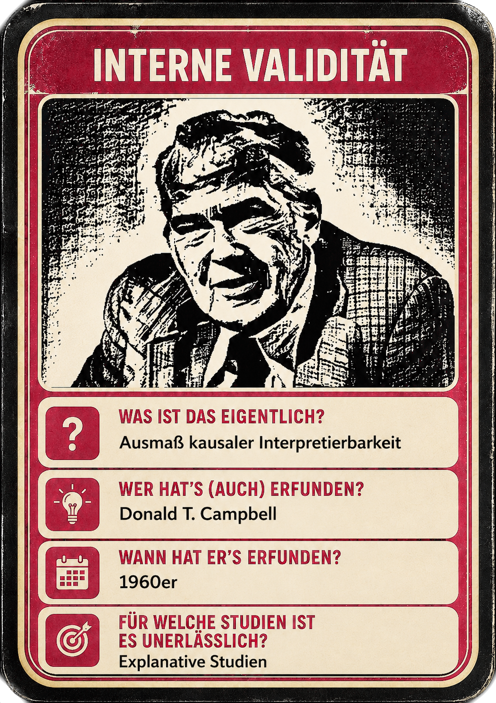
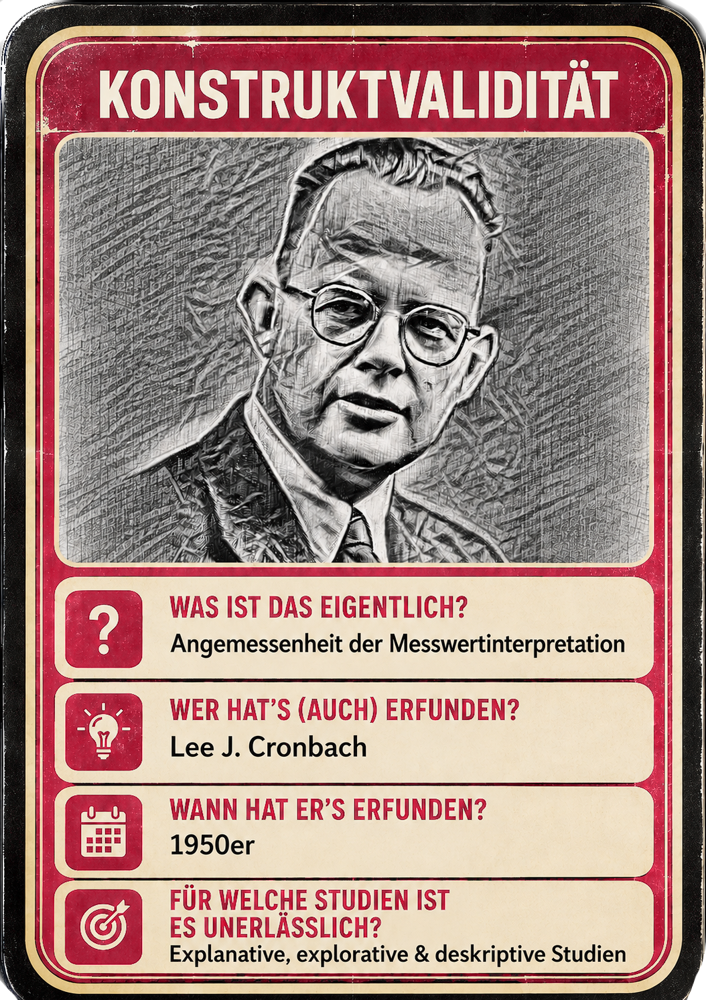
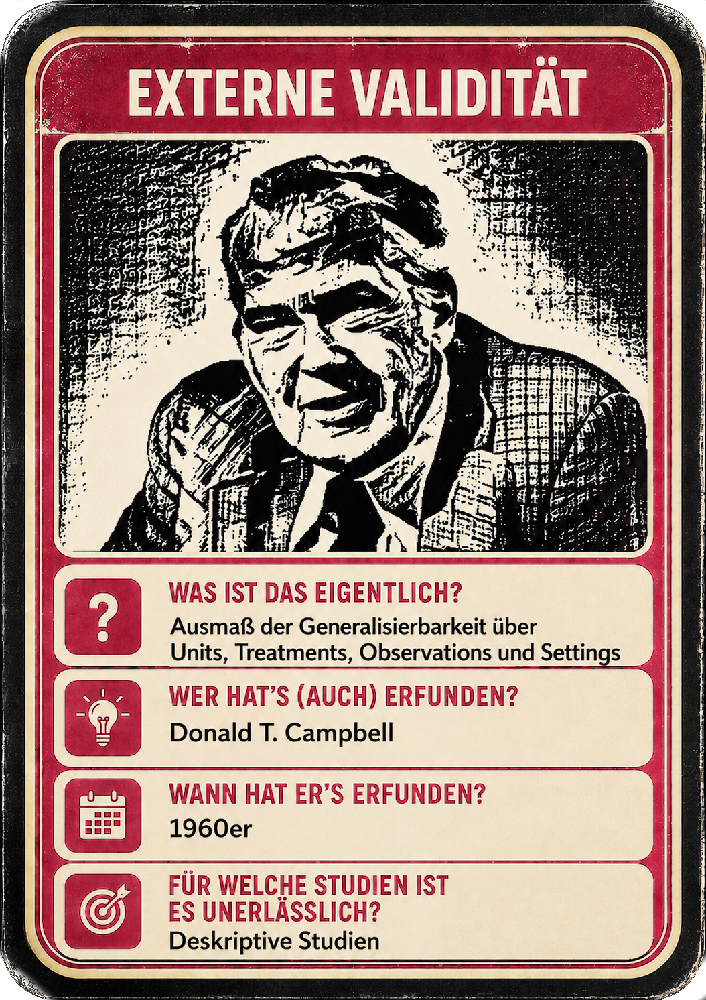
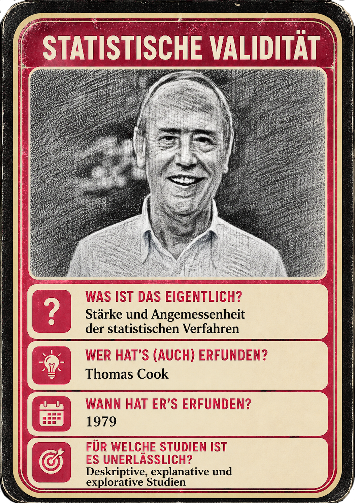
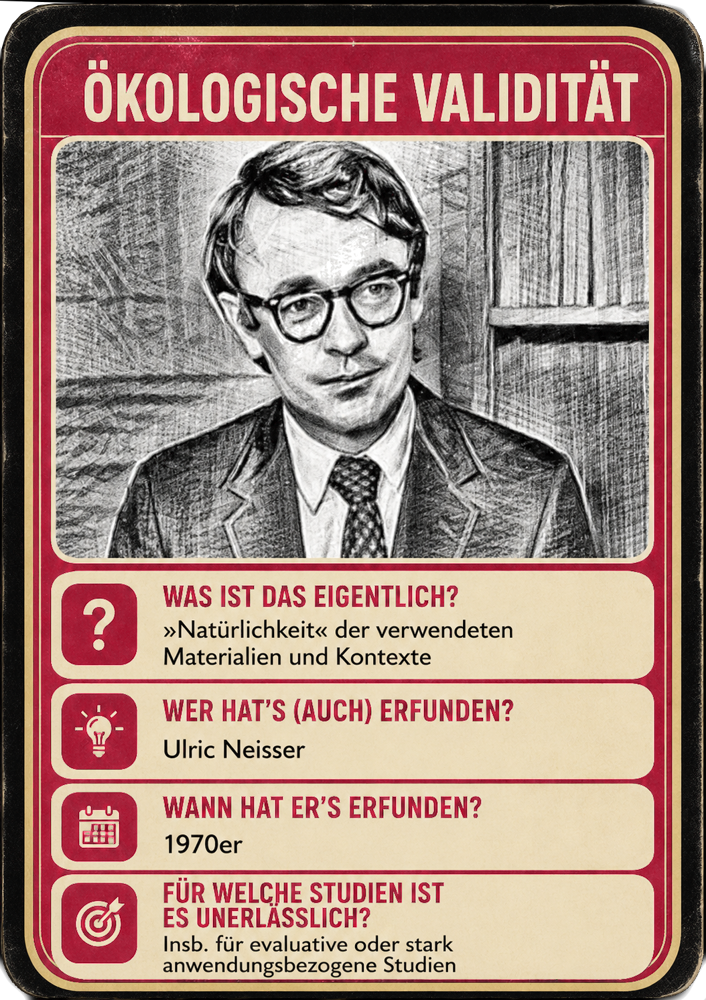
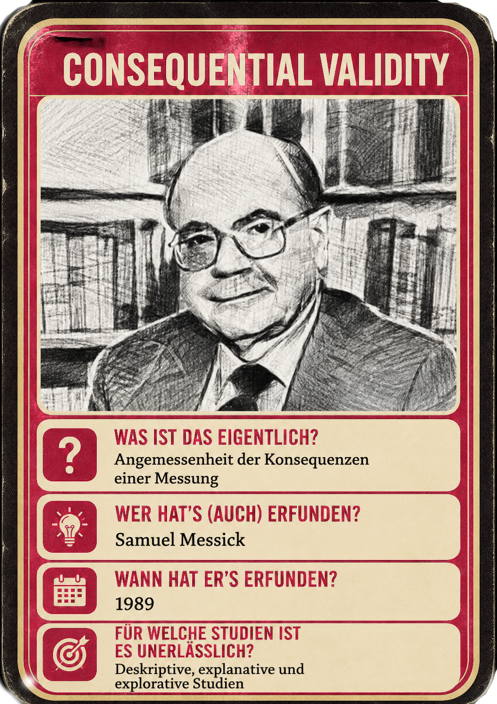

# Herzlich Willkommen!

## In diesem Teil 
* Mit wem haben Sie es zu tun?
* Welchen Gestaltungsvorschlag haben wir für die Vorlesung?
* Bildungswissenschaften? It's a mess!
    * Strukturierungsvorschläge:
        * Topologie beteiligter Disziplinen
        * Erkenntnisinteressen

## Mit wem haben Sie es zu tun?

::: {.columns}

::: {.column width="30%"}

::: {style="text-align: center;"}
{width=66%}

{width=66%}
:::

:::

::: {.column width="70%"}

::: {.timeline .vertical}
::: {.event data-label="2010" .tl-card}
Zweites Staatsexamen Mathematik, Chemie, Erziehungswissenschaft
:::
::: {.event data-label="bis 2016" .tl-card}
StR an der GSS Tübingen & wiss. Mitarbeiter UT
:::
::: {.event data-label="2020-2026" .tl-card}
TT-Prof. für empirische Schul- und Unterrichtsforschung an der PHKA
:::
::: {.event data-label="seit 2026" .tl-card}
Lehrstuhl Professionsforschung UT
:::
:::

:::

:::


## Gestaltungsvorschlag für die Vorlesung
* Modulhandbuch bindet uns an gewisse Inhalte, Lernziele und Prüfungsformen
* Modulhandbuch bindet uns auch an eine Prüfungsform:
    * 60 Minuten schriftliche Klausur (Multiple Choice, Kurzantworten, offene Fragen)
    * 03.02.2027 14:15, E-Prüfung auf Chromebooks des E-Prüfungszentrums
    * Zweittermin Anfang April 2027

## Gestaltungsvorschlag für die Vorlesung {.smaller}
* Mein Ziel: Nach der Vorlesung
    * verfügen Sie über ein **Vokabular**, das Ihnen erlaubt gewisse **Perspektiven** von Bildungswissenschaftler:innen **nachzuvollziehen** und diese kompetent zu **kritisieren**
    * können Sie **informiert entscheiden können,** ob Sie sich für Bildungswissenschaften interessieren
* Wie VL *gemeinsam* gestalten?
    * Vorschlag: Mindestens zwei Sitzungen zu **Themen Ihrer Wahl**
    * Vorschlag: Jede Woche (fakultative) Aufgaben während und nach der VL. Anschließend kurze Diskussion deren  [@biggs1996]
    * Weitere Vorschläge von Ihnen?

# Bildungswissenschaften?<br>It's a mess!

## Bildungswissenschaften {footer='false'}
```{r}
#| label: fig-dwds-verlauf
#| fig-cap: "Verlaufskurve „Bildungswissenschaften“ im DWDS-Zeitungskorpus [@dwds2026verlaufskurve]"
#| fig.background: '#F2F4F4'
#| lightbox: true
#| out-width: "90%"
#| fig-align: "left"
#| fig-width: 10
#| fig-height: 5

library(ggplot2)

# SVG-Quelle: eingeloggter Export der DWDS-Verlaufskurve (Zeitungskorpus,
# 1946-2026), da die zugrunde liegende Zeitreihe nicht über eine offene
# JSON-API verfügbar ist. Datenpunkte werden aus dem gnuplot-Pfad der
# heruntergeladenen SVG-Datei zurückgerechnet (Pixel -> Jahr/Frequenz).
svg_lines <- readLines("../images/bildungswissenschaften-v.svg")
txt <- paste(svg_lines, collapse = " ")

m <- regmatches(txt, regexpr("gnuplot_plot_2.*?stroke='rgb\\(  0, 135, 194\\)'\\s*d='([^']*)'", txt, perl = TRUE))
path_d <- sub(".*d='([^']*)'.*", "\\1", m)

coords <- regmatches(path_d, gregexpr("[0-9.]+,[0-9.]+", path_d))[[1]]
xy <- do.call(rbind, lapply(strsplit(coords, ","), as.numeric))
colnames(xy) <- c("x_px", "y_px")
xy <- as.data.frame(xy)

# Achsenkalibrierung anhand der Tick-Beschriftungen im SVG
# X: Pixel 58.64 = 1950, Pixel 277.30 = 2025
# Y: Pixel 156.00 = 0, Pixel 44.19 = 0.075
y_px_to_freq <- function(y) 0 + (y - 156.00) * (0.075 - 0) / (44.19 - 156.00)
xy$freq_per_mio <- y_px_to_freq(xy$y_px)

# 81 Punkte entsprechen exakt den Jahren 1946-2026 (Pixelabstände sind
# gleichmäßig, daher robuster als die noisy x-Pixel-Kalibrierung)
xy$jahr <- 1946:(1946 + nrow(xy) - 1)

df <- xy[, c("jahr", "freq_per_mio")]
names(df) <- c("jahr", "frequenz_pro_mio")

karminrot <- "#A51E37"
anthrazit <- "#32414B"

ggplot(df, aes(x = jahr, y = frequenz_pro_mio)) +
  geom_line(color = karminrot, linewidth = 1) +
  labs(
    title = "Verlaufskurve Begriffsprävalenz: „Bildungswissenschaft“",
    subtitle = "Relative Häufigkeit im DWDS-Zeitungskorpus",
    x = NULL,
    y = "Frequenz pro Mio. Tokens"
  ) +
  scale_x_continuous(breaks = seq(1950, 2025, by = 25)) +
  theme_minimal(base_family = "Arial", base_size = 18) +
  theme(
    plot.title = element_text(family = "Arial", color = karminrot, face = "bold"),
    plot.subtitle = element_text(color = anthrazit),
    axis.text = element_text(color = anthrazit),
    axis.title = element_text(color = anthrazit),
    panel.grid.minor = element_blank(),
    panel.grid.major = element_line(color = "grey90"),
    # Folienhintergrund: $ut-hintergrund = mix($ut-anthrazit, #ffffff, 6%)
    plot.background = element_rect(fill = "#F2F4F4", color = NA),
    panel.background = element_rect(fill = "#F2F4F4", color = NA)
  )
```

## Bildungswissenschaften {.smaller}
* Der Begriff der »Bildungswissenschaften« scheint ein recht junger zu sein (vgl. Verlaufskurve)
* Er ist oft  oder   [@terhart2012]
*   Er wird recht heterogen verwendet [@cramer2019b], im Kontext der Lehrer:innnenbildung aber oft als

    > *»diejenigen wissenschaftlichen Disziplinen und Teildisziplinen, die sich wissenschaftlich in jeder denkbaren theoretischen und methodischen Hinsicht [. . . ] auf Themen, Institutionen, Prozesse, Resultate von Bildung und Ausbildung beziehen«* [@terhart2012, S. 28]

    definiert.

## Bildungswissenschaften {.smaller}
*   Damit dient der Begriff auch als Sammelbegriff für die verschiedenen am Lehramtsstudium beteiligten Disziplinen neben den  und  [@terhart2012].
* Typischerweise gelten ,  und  als die Kern-Disziplinen der Bildungswissenschaften [@cramer2019b].

## Beispiele bildungswissenschaftlicher Studien
* Erziehungswissenschaft: @huebner2026a
* Soziologie: @neugebauer2025
* Psychologie: @basarkod2023

:::footer
Passende Übungsaufgabe: *Disziplinen in den Bildungswissenschaften*
:::

## Paradigmatische Vielfalt in den BW {.smaller}
> Die disziplinäre Vielfalt der BW bringt eine noch größere Vielfalt bzgl. der zugrunde liegenden  mit sich. Daher lohnt es sich ordnende Unterscheidungen zu kennen um Missverständnisse (und daraus resultierende Enttäuschungen) zu vermeiden.

## Erkenntnisinteressen in den BW {.smaller}
Erkenntisinteressen können in den Bildungswissenschaften auf die unterscheidlichsten Weisen gegliedert werden. Für eine erste Orientierung können die folgenden Unterscheidungen dienen [@doering2016; @patry2023a; @habermas2019]:

### Tend. naturwiss. Erkenntnisinteressen:
* **** (Beispielforschungsfrage: *Welcher Anteil männlicher 15-jähriger in Deutschland sind ?*)
* **** (Beispielforschungsfrage: *Welche Wirkung haben Lautleseverfahren auf die Leseflüssigkeit?*)
* **** (Beispielforschungsfrage: *Was könnten Ursachen für Studienabbruch bei Lehramtsstudierenden sein?*)
* **** (Beispielforschungsfrage: *Wie kann mit administrativen  das Abbruchrisiko vorhergesagt werden?*)

:::footer
Passende Übungsaufgabe: *Erkenntnisinteressen in den Bildungswissenschaften*
:::

## {.smaller}
### Tend. geisteswiss. Erkenntnisinteressen:
* **** (Beispielforschungsfrage: *Wie erlebt Kind A den Übergang von einer behüteten Grundschule in ein großen Gymnasium*)
* **** (Beispielforschungsfrage: *Wie reproduzieren Hidden Curricula soziale Ungleichheit*)


## Beispiel unklarer Erkenntnisinteressen

::: {.columns style="display: flex !important; align-items: center;"}

::: {.column width="30%"}
<iframe src="https://www.instagram.com/reel/Det3hxcq7S3/embed"
        width="300" height="500"
        frameborder="0" scrolling="no" allowtransparency="true"
        allowfullscreen></iframe>
:::

::: {.column width="70%"}
<center>
 -  - 

Wie beurteilen Sie die Passung der Erkenntnisinteressen der Influencerin zum Erkenntnisinteresse der Forschenden?
</center>
:::

:::

## »Studien« in den BW {.smaller}
Die vielfältigen Erkentnissinteressen in den BW führen zu noch größerer Vielfalt an Forschungsmethoden. Eine sehr grobe Gliederung liefert die folgende Abbbildung:

:::{style="text-align:center"}
{width=100%}
:::
```{mermaid}
%%| eval: false

---
config:
  flowchart:
    theme: redux-color
    curve: linear
    useMaxWidth: false
    nodeSpacing: 10
    rankSpacing: 30
---
flowchart TD
    A[Forschungsmethoden<br/>in den Bildungswissenschaften]

    A --> B[Nicht-empirische Methoden]
    A --> C[Empirische Methoden]

    B --> B1[Hermeneutik]
    B --> B2[Phänomenologie]
    B --> B3[Kritische Theorie]
    B --> B4[..]

    C --> D[Qualitative Methoden]
    C --> E[Quantitative Methoden]

    D --> D1[Kasuistik]
    D --> D3[Dokumentarische Methode]
    D --> D4[Grounded Theory]
    D --> D5[Qualitative Inhaltsanalyse]
    D --> D2[...]

    E --> F[Experimentelle Methoden]
    E --> G[Nicht-experimentelle Methoden]

    F --> F1[Quasi-Experiment]
    F --> F2[Randomisiertes Experiment]
    F --> F3[Randomisiert Kontrolliertes Experiment]
    F --> F4[...]

    G --> G1[Survey]
    G --> G2[Beobachtung]
    G --> G3[Trendstudie]
    G --> G4[Panelstudie]
    G --> G5[...]


    classDef root fill:#32414B,color:#fff,stroke:#32414B
    classDef nonemp fill:#B4A069,color:#fff,stroke:#B4A069
    classDef emp fill:#a51e37,color:#fff,stroke:#a51e37
    classDef qual fill:#a51e3795,color:#fff,stroke:#a51e37
    classDef quant fill:#a51e3770,color:#32414B,stroke:#a51e37

    class A root
    class B,B1,B2,B3,B4 nonemp
    class C emp
    class D,D1,D2,D3,D4,D5 qual
    class E,F,G,F1,F2,F3,F4,G1,G2,G3,G4,G5 quant
```

## Gütekriterien für »Studien« in den BW {.smaller}
Während für die nicht-empirischen und qualitativen Forschungsmethoden keine Einigung über einen Kanon an Gütekriterien besteht [@flick2010; @steinke1999], gelten in der Community der
quantitativen Forschungsmethoden die folgenden Kriterien [erweiterte Campbelltradition, @campbell1963] als vergleichsweise unumstritten:

::: {.columns}

::: {.column width=16%}

{.lightbox}

:::

::: {.column width=16%}

{.lightbox}

:::

::: {.column width=16%}

{.lightbox}

:::


::: {.column width=16%}

{.lightbox}

:::

::: {.column width=16%}

{.lightbox}

:::

::: {.column width=16%}

{.lightbox}

:::
:::

::: footer
✨ Passende Übungsaufgaben: *Disziplinen in den Bildungswissenschaften*
:::


## Steigerung der internen Validität {.smaller}
:::{.incremental}
* 
* 
* 
* 
* 
* 
* 
* 
:::

## Steigerung der externen Validität {.smaller}
:::{.incremental}
* 
* 
* 
* 
* 
:::


## Literatur {.smaller}
