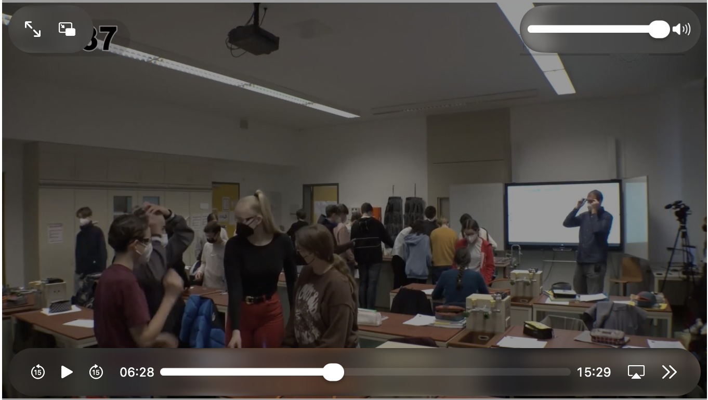
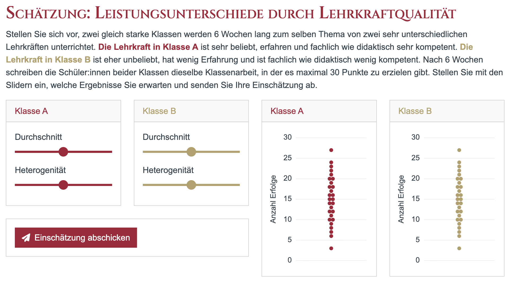

```{r}
#| include: false
knitr::knit_engines$set(typst = function(options) {
  knitr::asis_output(paste0("\n```{.typst-render-cell}\n", paste(options[["code"]], collapse = "\n"), "\n```\n"))
})
```

## In diesem Teil  {.center}
* Charakteristika des Lehrer:innenberufs
* Profession - Professionalität - Professionalisierung
* Struktur- und kompetenztheoretischer Ansatz der Professionalität von Lehrer:innen
* Einblicke in Forschungsergebnisse


##  {background-iframe="https://cdn.wordart.com/iframe/hhnsou380o8n" background-interactive=true}

:::footer
:::

## Charakteristika des Unterrichts
Nach Doyle [-@doyle1986] ist Unterricht durch die folgenden Eigenschaften in seiner Besonderheit charakterisiert [@cramer2025professionalitaet]:

::: {style="font-size: 80%;"}
+------------------------+------------------------------------------------------------------------------------------------+
| Multidimensionalität   | Viele, sehr verschiedene Ereignisse finden aufgrund der vielen Personen im Klassenraum statt.  |
+------------------------+------------------------------------------------------------------------------------------------+
| Simultanität           | Viele Dinge geschehen gleichzeitig im Unterricht.                                              |
+------------------------+------------------------------------------------------------------------------------------------+
| Unmittelbarkeit        | Aufgrund des schnellen Ablaufes von Ereignissen im Unterricht ist ein unmittelbares            |
|                        | Lehrer:innenhandeln gefordert, welches eine Reflexion erschwert.                               |
+------------------------+------------------------------------------------------------------------------------------------+
| Unvorhersehbarkeit     | Unterricht kann nicht sicher vorhergesehen und nur beschränkt geplant werden.                  |
+------------------------+------------------------------------------------------------------------------------------------+
| Öffentlichkeit         | Interaktionen finden in einem „öffentlichen“ Raum statt und gehen dabei über den Kreis der     |
|                        | direkt Beteiligten hinaus.                                                                     |
+------------------------+------------------------------------------------------------------------------------------------+
| Historizität           | Gegenwärtiges Handeln im Klassenzimmer hat immer Wurzeln in der Vergangenheit und Auswirkungen |
|                        | in die Zukunft.                                                                                |
+------------------------+------------------------------------------------------------------------------------------------+
| Intransparenz          | Lehrperson und Schüler:innen können gegenseitig nur erahnen, was im jeweils anderen vor sich   |
|                        | geht und nur über (störanfällige) Kommunikation aufeinander Einfluss nehmen.                   |
+------------------------+------------------------------------------------------------------------------------------------+
| Informalität           | Unterrichten ist situativ und nur in geringem Ausmaß standardisierbar oder reglementierbar.    |
+------------------------+------------------------------------------------------------------------------------------------+
:::


## {.center}
### Charakteristika des Unterrichts $\overset{?}{\Rightarrow}$ Anforderungen an LuL
> Welche Anforderungen an die Qualitäten von Lehrkräften lassen sich aus diesen Charakteristika ableiten?

> Formulieren Sie  Eigenschaften von Lehrkräften, die diese Anforderungen notwendig machen unter [https://bab.si/biwi-merk-2627](https://bab.si/biwi-merk-2627) und »voten« Sie die Vorschläge Ihrer Kommiliton:innen.


# Anforderungen an Lehrer:innen
## Anforderungen an Lehrer:innen
Diese Charakteristika [@doyle1986] des Kerngeschäfts Unterricht [@tenorth2006c] stehen teilweise im Widerspruch zu personalistischen und praktizistischen Metaphern des Lehrer:innenberufs, nach denen professionelle Lehrer:innen »gute, erfahrene Handwerker«, bzw. »begnadete Erzieher« [@terhart2019] sind:

* Die Tragfähigkeit der praktizistischen Metapher wird vor allem bzgl. des sehr großen Möglichkeitsraumes kritisiert: Im Gegensatz zu etwa der Tätigkeit einer Pilotin, sind einige Tätigkeiten von LuL wesentlich weniger standardisierbar, weshalb »Checklisten« so umfangreich wären, dass sie nicht mehr hilfreich sind
* Personalistische Metaphern werden als  kritisiert [@bromme2008d], da  und  fast gleich sind:

```{typst}
//| format: svg
//| align: center
#set text(size: 18pt)
$
  "gute Lehrer:innenpersönlichkeit" &==> "erfolgreiche Lehrer:in" \
  &arrow.l.r.double.long \
  "erfolgreiche Lehrer:in" &==> "erfolgreiche Lehrer:in"
$
```

## Begriffe
#### Profession
Aus berufssoziologischer Perspektive wird eine Profession einerseits als besonderer, herausgehobener Beruf aufgefasst [@freidson2001], andererseits als Beruf, der durch Risiken und Ungewissheit in der Ausübung durch Professionelle (Berufsinhabende) charakterisiert ist [@stichweh1994].

#### Professionalität
Professionalität beschreibt die »*spezifische Qualität des beruflichen Handelns*« [@horn2016, S. 156].

#### Professionalismus
Das, was eine Profession ( und kollektiv) unter Professionalität versteht, lässt sich als Professionalismus fassen [@horn2016, S. 156].

## Begriffe
#### Professionalisierung
»*Der Begriff Professionalisierung wird in zwei Absichten verwendet. Bezieht er sich auf die Professionen
selbst, so meint er in historischer Absicht den Transformationsprozess eines gewöhnlichen Berufes hin zur
Profession (Professionwerdung); wird er hingegen auf die Professionellen bezogen, meint er das individuelle
Hervorbringen von Professionalität (Professionellwerden). Heute wird unter Professionalisierung
überwiegend die (individuelle) Entwicklung von Professionalität verstanden.*« [@cramer2025professionalitaet]

# 1. Ansatz: Expertiseforschung

## Expertiseforschung
### Liveexperiment

[{width=50%}](https://tetfolio.fu-berlin.de/tet/focus-video?vid=184)


> Beschreiben Sie das beobachtete Unterrichtsgeschehen *charakterisierend* unter [https://bab.si/biwi-merk-2627](https://bab.si/biwi-merk-2627). Verwenden Sie dazu mindestens zwei vollständige Sätze 😇. Ihre Ergebnisse werden später aufgegriffen.


<!-- https://tetfolio.fu-berlin.de/tet/focus-video?vid=184 -->

## Expertiseforschung

::: {.columns}

::: {.column width="29%"}

```{typst}
//| label: fig-aufstellunglogisch
//| fig-align: left
// Aufstellung 4-2-3-1 im UT-Farbschema
#let karminrot = rgb("#A51E37")
#let mattgold = rgb("#B4A069")
#let anthrazit = rgb("#32414B")
#let sand = rgb("#EEE9DD")

#set text(font: ("Helvetica Neue", "Arial", "Liberation Sans"), fill: anthrazit)

#let W = 8cm
#let H = 11cm
#set page(width: auto, height: auto, margin: 0pt)
#let line-style = 1.2pt + mattgold

#let player(x, y, name, pos, gk: false) = place(
  top + left,
  dx: x * W - 2.5cm,
  dy: y * H - 0.6cm,
  box(width: 5cm, align(center, box(
    fill: if gk { mattgold } else { sand },
    radius: 4pt,
    inset: (x: 6pt, y: 4pt),
    text(size: 10pt, weight: "bold", fill: anthrazit, name),
  ))),
)

#align(center)[
  #box(width: W, height: H, {
    // Spielfeld
    place(top + left, rect(width: W, height: H, fill: anthrazit, stroke: 2pt + mattgold, radius: 4pt))
    // Mittellinie und Mittelkreis
    place(top + left, dy: H / 2, line(length: W, stroke: line-style))
    place(top + left, dx: W / 2 - 1.6cm, dy: H / 2 - 1.6cm, circle(radius: 1.6cm, stroke: line-style))
    place(top + left, dx: W / 2 - 0.1cm, dy: H / 2 - 0.1cm, circle(radius: 0.1cm, fill: mattgold, stroke: none))
    // Strafräume
    place(top + left, dx: (W - 8cm) / 2, dy: 0cm, rect(width: 8cm, height: 3cm, stroke: line-style))
    place(top + left, dx: (W - 8cm) / 2, dy: H - 3cm, rect(width: 8cm, height: 3cm, stroke: line-style))
    // Fünfmeterräume
    place(top + left, dx: (W - 3.6cm) / 2, dy: 0cm, rect(width: 3.6cm, height: 1cm, stroke: line-style))
    place(top + left, dx: (W - 3.6cm) / 2, dy: H - 1cm, rect(width: 3.6cm, height: 1cm, stroke: line-style))

    // Sturm
    player(0.5, 0.09, "Havertz", "ST")
    // Offensives Mittelfeld
    player(0.2, 0.27, "Wirtz", "LA")
    player(0.5, 0.27, "Gnabry", "ZOM")
    player(0.8, 0.27, "Sané", "RA")
    // Defensives Mittelfeld
    player(0.36, 0.47, "Stiller", "ZDM")
    player(0.64, 0.47, "Goretzka", "ZDM")
    // Abwehr
    player(0.14, 0.68, "Raum", "LV")
    player(0.38, 0.70, [Schlotter-#linebreak()beck], "IV")
    player(0.62, 0.70, "Tah", "IV")
    player(0.86, 0.68, "Kimmich", "RV")
    // Tor
    player(0.5, 0.91, "Baumann", "TW", gk: true)
  })
]

```

:::

::: {.column width="29%"}

```{typst}
//| label: fig-aufstellung-zufall
//| fig-align: left
// Aufstellung 4-2-3-1 im UT-Farbschema, zufällige Positionen
#let mattgold = rgb("#B4A069")
#let anthrazit = rgb("#32414B")
#let sand = rgb("#EEE9DD")

#set text(font: ("Helvetica Neue", "Arial", "Liberation Sans"), fill: anthrazit)

#let W = 8cm
#let H = 11cm
#set page(width: auto, height: auto, margin: 0pt)
#let line-style = 1.2pt + mattgold

#let player(x, y, name, pos, gk: false) = place(
  top + left,
  dx: x * W - 2.5cm,
  dy: y * H - 0.6cm,
  box(width: 5cm, align(center, box(
    fill: if gk { mattgold } else { sand },
    radius: 4pt,
    inset: (x: 6pt, y: 4pt),
    text(size: 10pt, weight: "bold", fill: anthrazit, name),
  ))),
)

#align(center)[
  #box(width: W, height: H, {
    // Spielfeld
    place(top + left, rect(width: W, height: H, fill: anthrazit, stroke: 2pt + mattgold, radius: 4pt))
    // Mittellinie und Mittelkreis
    place(top + left, dy: H / 2, line(length: W, stroke: line-style))
    place(top + left, dx: W / 2 - 1.6cm, dy: H / 2 - 1.6cm, circle(radius: 1.6cm, stroke: line-style))
    place(top + left, dx: W / 2 - 0.1cm, dy: H / 2 - 0.1cm, circle(radius: 0.1cm, fill: mattgold, stroke: none))
    // Strafräume
    place(top + left, dx: (W - 8cm) / 2, dy: 0cm, rect(width: 8cm, height: 3cm, stroke: line-style))
    place(top + left, dx: (W - 8cm) / 2, dy: H - 3cm, rect(width: 8cm, height: 3cm, stroke: line-style))
    // Fünfmeterräume
    place(top + left, dx: (W - 3.6cm) / 2, dy: 0cm, rect(width: 3.6cm, height: 1cm, stroke: line-style))
    place(top + left, dx: (W - 3.6cm) / 2, dy: H - 1cm, rect(width: 3.6cm, height: 1cm, stroke: line-style))

    // Positionen wie in Abbildung 1, Namen vertauscht
    player(0.5, 0.09, "Stiller", "ST")
    player(0.2, 0.27, "Kimmich", "LA")
    player(0.5, 0.27, "Havertz", "ZOM")
    player(0.8, 0.27, "Tah", "RA")
    player(0.36, 0.47, "Raum", "ZDM")
    player(0.64, 0.47, "Baumann", "ZDM")
    player(0.14, 0.68, "Goretzka", "LV")
    player(0.38, 0.70, "Wirtz", "IV")
    player(0.62, 0.70, "Gnabry", "IV")
    player(0.86, 0.68, [Schlotter-#linebreak()beck], "RV")
    player(0.5, 0.91, "Sané", "TW", gk: true)
  })
]

```

:::


::: {.column width="42%"}

```{r}
#| include: false
library(ggplot2)
set.seed(7316)

lev <- c("Expert:innen", "Desinteressierte")
daten <- expand.grid(
  id = 1:25,
  gruppe = lev,
  abbildung = c("Abbildung 1 (sinnvoll)", "Abbildung 2 (vertauscht)")
)
daten$p <- with(daten, ifelse(
  abbildung == "Abbildung 1 (sinnvoll)",
  ifelse(gruppe == "Expert:innen", 0.80, 0.30),
  ifelse(gruppe == "Expert:innen", 0.28, 0.27)
))
daten$richtig <- rbinom(nrow(daten), size = 11, prob = daten$p)
d2 <- transform(daten, gruppe = factor(gruppe, levels = lev))

n_exp <- sum(d2$gruppe == "Expert:innen" & d2$abbildung == "Abbildung 1 (sinnvoll)" & d2$richtig == 8)
n_des <- sum(d2$gruppe == "Desinteressierte" & d2$abbildung == "Abbildung 2 (vertauscht)" & d2$richtig == 5)
d <- 0.135
anno <- data.frame(
  gruppe = factor(lev, levels = lev),
  abbildung = c("Abbildung 1 (sinnvoll)", "Abbildung 2 (vertauscht)"),
  x_txt = c(-0.3, 6.2), y_txt = c(1.0, 1.05),
  x_start = c(4.2, 6.9), y_start = c(0.62, 0.5),
  x_dot = c(7.6, 5.4), y_dot = c(n_exp, n_des) * d - d / 2,
  label = c(sprintf("%s Expert:innen haben\n8 Spieler korrekt aus\nAbb. 1 rekonstruiert", n_exp),
            sprintf("%s Desinteressierte\nhaben 5 Spieler\nkorrekt aus Abb. 2\nrekonstruiert", n_des))
)

p <- ggplot(d2, aes(richtig, fill = gruppe)) +
  geom_dotplot(binwidth = 1, stackgroups = TRUE, binpositions = "all",
               method = "histodot", dotsize = 0.9, colour = "white") +
  geom_text(data = anno, aes(x_txt, y_txt, label = label),
            hjust = 0, vjust = 1, size = 3.3, colour = "#32414B", lineheight = 0.95,
            inherit.aes = FALSE) +
  geom_curve(data = anno[1, ], aes(x = x_start, y = y_start, xend = x_dot, yend = y_dot),
             curvature = 0.3, colour = "#32414B", linewidth = 0.5,
             arrow = arrow(length = unit(2.5, "mm"), type = "closed"), inherit.aes = FALSE) +
  geom_curve(data = anno[2, ], aes(x = x_start, y = y_start, xend = x_dot, yend = y_dot),
             curvature = -0.4, colour = "#32414B", linewidth = 0.5,
             arrow = arrow(length = unit(2.5, "mm"), type = "closed"), inherit.aes = FALSE) +
  facet_grid(gruppe ~ abbildung, axes = "all_x", axis.labels = "all") +
  scale_fill_manual(values = c("Expert:innen" = "#A51E37", "Desinteressierte" = "#B4A069")) +
  scale_x_continuous(limits = c(-0.5, 11.5), breaks = 0:11) +
  scale_y_continuous(NULL, breaks = NULL, limits = c(0, 1.1)) +
  labs(x = "Korrekt rekonstruierte Spieler (von 11)", fill = NULL) +
  theme_minimal(base_size = 13) +
  theme(
    text = element_text(colour = "#32414B"),
    panel.grid = element_blank(),
    axis.line.x = element_line(colour = "#32414B"),
    strip.text = element_text(face = "bold", colour = "#32414B"),
    legend.position = "none"
  )

ggsave("../images/dotplot-erwartung.svg", p, width = 7, height = 5, dpi = 200, bg = "white")
```

Angenommen in einem  schauen **50 Fußballexpert:innen** und **50 Fußballdesinteressierte** 5 Sekunden lang auf entweder Abbildung 1 oder Abbildung 2 und müssen danach die Aufstellung der Spieler rekonstruieren. Welche Daten würden Sie erwarten? Weshalb machen [diese Daten](../images/dotplot-erwartung.svg) Sinn?
:::

:::


## Studien zur Schachexpertise ✨{.scrollable}
In berühmten Experimenten von Adriaan de Groot [@degroot1965], William Chase und Herbert Simon [@chase1973a; @chase1973b] wurde die Expertise von Schachspieler:innen untersucht.

### Der Versuchsaufbau

- **Probandengruppen:** Verglichen wurden drei Spieler unterschiedlicher Kompetenzstufen – ein **Schachmeister** (unter den Top 25 der USA), ein **guter Vereinsspieler** und ein **Anfänger**.

- **Darbietung:** Den Probanden wurde ein Schachbrett mit einer Stellung aus einer echten Partie (Mittel- oder Endspiel) für genau **5 Sekunden** gezeigt.

- **Reproduktion:** Direkt im Anschluss mussten die Spieler versuchen, die gesehene Stellung aus dem Gedächtnis auf einem zweiten, leeren Schachbrett aufzustellen.

- **Wiederholung & Kriterium:** Nach jedem Versuch durften die Probanden erneut für 5 Sekunden auf die Vorlage blicken. Dieser Vorgang wurde so lange wiederholt, bis die Position korrekt reproduziert war. Als Gütekriterium galt die Anzahl der benötigten 5-Sekunden-Betrachtungen.

- **Testmaterial:** Das Experiment wurde mit **20 echten Spielstellungen** durchgeführt. Ergänzend wurden **8 Zufallsaufstellungen** mit einer identischen Anzahl an Figuren einbezogen, bei denen die Figuren völlig beliebig auf dem Brett verteilt waren.

### Die Ergebnisse

- **Bei echten Schachstellungen:**
  - Der **Schachmeister** konnte bereits nach dem ersten 5-sekündigen Hinsehen durchschnittlich **16 Figuren** korrekt platzieren und benötigte insgesamt nur 3 bis 4 Betrachtungen für eine fehlerfreie Rekonstruktion.
  - Der **gute Spieler** platzierte beim ersten Blick durchschnittlich **8 Figuren** (und benötigte 1–2 Betrachtungen mehr als der Meister).
  - Der **Anfänger** schaffte beim ersten Mal nur **4 Figuren** und brauchte bis zu 14 Betrachtungen.

- **Bei Zufallsaufstellungen:**
  - Sobald die Figuren zufällig verteilt waren und keine sinnvolle Schachstruktur bildeten, verschwanden die Leistungsunterschiede vollständig; der Meister schnitt nicht besser ab als der Anfänger.


### Theoretische Erklärung
Chase und Simon folgerten aus den Ergebnissen, dass Schachmeister weder über ein generell besseres Kurzzeitgedächtnis noch über eine höhere allgemeine Gedächtniskapazität verfügen. De Groot stellte zudem fest, dass Meister nicht wesentlich mehr Züge vorausdenken (etwa 2–3 Züge) oder mehr Alternativen erwägen (30–50 bei einer schwierigen Stellung) als schwächere Spieler.
Der entscheidende Vorteil liegt in der visuell-perzeptiven Wahrnehmung: Experten verfügen über ein im Langzeitgedächtnis gespeichertes Repertoire an typischen Konstellationen und Bedeutungseinheiten (sogenannten ). Sie erfassen das Brett nicht als Ansammlung einzelner Figuren, sondern in dicht gepackten Mustern. Längere Pausen beim Aufstellen der Figuren (über 2 Sekunden) gaben den Forschern dabei Aufschluss über die Grenzen zwischen diesen einzelnen Chunks.

:::{.footer}
:::

## Studien zur Physikexpertise ✨{.scrollable}
### Der Versuchsaufbau
- **Probandengruppen:** Chi et al [-@chi1981] verglichen **Physik-Experten** (Doktoranden oder Hochschullehrer der Physik) und **Anfänger** (Studenten nach einem einführenden Kurs in Mechanik).
- **Aufgabenstellung:** Den Probanden wurden Textaufgaben aus der Mechanik oder Thermodynamik vorgelegt, die sie in einem Experiment frei nach Ähnlichkeit sortieren sollten. In weiteren Experimenten wurden Verbalprotokolle des Lauten Denkens beim eigentlichen Problemlösen erhoben.

### Die Ergebnisse
- **Anfänger** sortierten die Textaufgaben nach **Oberflächenmerkmalen**, also nach den konkret genannten physischen Objekten (z. B. schiefe Ebene, Rollen, Seile). Beim Lösen dachten sie vom Ziel her („Rückwärts-Arbeiten") und ersetzten Variablen Schritt für Schritt.
- **Experten** gruppierten die Aufgaben nach **Tiefenstrukturen bzw. physikalischen Prinzipien** (z. B. Erhaltung der Energie, 2. Newtonsches Gesetz). Sie sahen physikalische Objekte sofort im Kontext von Lösungsprozeduren und mathematischen Gleichungen. Beim Problemlösen arbeiteten sie datengeleitet von den gegebenen Werten aus („Vorwärts-Arbeiten") und setzten Zahlen direkt in das passende Prinzip ein.

### Theoretische Erklärung
Experten besitzen kein generell überlegenes Gedächtnis, sondern verfügen über ein Wissen, das um **abstrakte physikalische Gesetze** herum kohärent organisiert ist. Die Fachstruktur und das funktionale Problemverständnis verschmelzen bei ihnen, was ein unmittelbares, intuitives Erkennen des Problemtyps ermöglicht.


:::{.footer}
:::

## Studien zur Lehrer:innenexpertise ✨{.scrollable}
### Der Versuchsaufbau:
- **Probandengruppen:** Berliner und Mitarbeiter [-@berliner1992] verglichen drei Gruppen: **Experten** (Lehrkräfte mit mindestens 5 Jahren Berufserfahrung und hervorragenden Beurteilungen), **Anfänger** (Lehrkräfte im ersten Berufsjahr) und **Anwärter** (Ingenieure/Naturwissenschaftler ohne pädagogische Ausbildung).
- **Darbietung & Simulation:**
    1. *Wahrnehmung von Unterrichtsszenen:* Dias von Unterrichtssituationen wurden kurz für 1 bis 3 Sekunden gezeigt oder als Bildserie vorgeführt.
    2. *Verarbeitung von Schülerinformationen:* Die Probanden sollten anhand von Schülerakten, Noten, Tests und Lehrbüchern in 40 Minuten die Übernahme einer fremden Klasse vorbereiten; anschließend folgte ein Gedächtnistest zu Schülerdetails.

### Die Ergebnisse:
- **Wahrnehmung von Unterrichtsdias:**
    - **Anfänger und Anwärter** beschrieben visuelle **Oberflächendetails** wie Haarfarbe, Geschlecht, Raumausstattung oder die genaue Sitzordnung.
    - **Experten** nutzten **abstraktere pädagogische Begriffe** (sahen z. B. „Gruppenarbeit" statt bloß „miteinander redender Schüler"). Sie erkannten sofort typische vs. untypische Unterrichtsstrukturen und fokussierten sich auf die Schüleraktivitäten und den Unterrichtsfluss.
- **Verarbeitung schriftlicher Schülerdaten:**
    - **Anfänger und Anwärter** behielten nach der Vorbereitung sehr viele **demographische Fakten und Einzeldetails** über Schüler im Gedächtnis.
    - **Experten** schnitten beim Behalten isolierter demographischer Schülerdetails schlecht ab. Sie filterten unwichtige Fakten und verschmolzen die Einzeldaten zu einem handlungsrelevanten **Gesamtbild der Klasse („Kollektiver Schüler")**. Zudem richteten sie ihre Aufmerksamkeit stark auf den Stand der Stoffentwicklung und fachdidaktische Techniken.

### Theoretische Erklärung:
Berliner erklärt die Befunde durch Unterschiede in der **kategorialen Wahrnehmung**. Experten verfügen im Langzeitgedächtnis über **Schemata und Prototypen typischer Unterrichtsereignisse (»Aktivitätsszenarien«)**. Begriffe über Schüler sind bei Experten eng an situative Handlungskontexte gebunden (Erfahrungs- und Situationsbezug), wodurch sie relevante von irrelevanten Informationen für die Erfordernisse der Klassenführung trennen können.

:::{.footer}
:::

## Einschätzung
> Angenommen es gibt Expert:innen Noviz:innen im Lehrer:innenberuf. Wie stark unterscheiden sich die Leistungen deren Schüler:innen?  Bearbeiten Sie die [folgende Einschätzung ](../apps/Teil%202%20-%20Professionalität/effsize-teacherqual.html)

[{width=60%}](../apps/Teil%202%20-%20Professionalität/effsize-teacherqual.html)

## Ihre Ergebnisse

```{r}
#| echo: false
#| label: fig-ps-histogramm
library(googlesheets4)
library(ggplot2)

gs4_deauth()
antw <- read_sheet(
  "https://docs.google.com/spreadsheets/d/1Gk6aRTdfF_KftuLhukly7VUd7gwxOdejypDEe_2CWsU/edit?usp=sharing",
  sheet = "Antworten"
)

n_bal <- sum(antw$PS > 0.8 & antw$PS <= 0.85)

ggplot(antw, aes(PS)) +
  geom_histogram(binwidth = 0.05, boundary = 0, fill = "#A51E37", colour = "white") +
  annotate("text", x = 0.4, y = 30, hjust = 0, vjust = 1, size = 5, colour = "#32414B",
           lineheight = 0.95,
           label = sprintf("%s Studierende schätzen die PS\nzwischen 0,8 und 0,85 ein", n_bal)) +
  annotate("curve", x = 0.72, y = 26, xend = 0.815, yend = n_bal + 0.5, curvature = -0.3,
           colour = "#32414B", linewidth = 0.5,
           arrow = arrow(length = unit(2.5, "mm"), type = "closed")) +
  scale_x_continuous(breaks = seq(0, 1, 0.1)) +
  scale_y_continuous(expand = expansion(mult = c(0, 0.05))) +
  coord_cartesian(xlim = c(0, 1.02)) +
  labs(x = "Probability of Superiority", y = "Anzahl Ihrer Einschätzungen",
       caption = paste(strwrap("Wahrscheinlichkeit eines/einer zufällig gewählten Schüler:in der starken Lehrkraft, mehr Punkte in der Klassenarbeit zu bekommen.", 85), collapse = "\n")) +
  theme_minimal(base_size = 14) +
  theme(
    text = element_text(colour = "#32414B"),
    plot.background = element_rect(fill = "#F3F4F4", colour = NA),
    panel.background = element_rect(fill = "#F3F4F4", colour = NA),
    panel.grid.major.x = element_blank(),
    panel.grid.minor = element_blank(),
    axis.line.x = element_line(colour = "#32414B"),
    plot.caption = element_text(hjust = 0, size = 10),
    plot.caption.position = "plot"
  )

```

## Ergebnisse klassischer Teacher Value-Added Studien
:::{style="font-size: 86%;"}
Entgegen Ihrer Annahme, dass Lehrer:innenexpertise die Schüler:innenleistung sehr, sehr stark beeinflusst, zeigen klassische  Studien, dass der Effekt von Lehrer:innenmerkmalen auf die Schüler:innenleistung eher gering ist (siehe für einen Überblick). Die Grundidee der Modelle [@hanushek1971teacher] ist Schüler:innenleistung am Ende eines Schuljahres statistisch um Vortestleistungen, sozioökonomischen Status etc. zu adjustieren, um dann die Abweichung eines Klassenmittelwertes von der erwarteten Leistung zu betrachten. Diese Abweichung wird dann als Effekt der Lehrkraft interpretiert. Sehr grob abgeschätzt, kann man von einem Unterschied von ca. 3 Lernmonaten ausgehen, wenn Klassen von Lehrkräften am oberen Mittelfeld versus Lehrkräfte am unteren Mittelfeld unterrichtet werden [@neugebauer2013lehrer]

> Welche Kritik an der internen & externen Validität der klassischen Teacher Value-Added Studien können Sie sich vorstellen? Formulieren Sie Ihre Ideen unter [https://bab.si/biwi-merk-2627](https://bab.si/biwi-merk-2627) (🙏🏽🙏🏽 biddebidde in ganzen Sätzen 😳) und »voten« Sie die Vorschläge Ihrer Kommiliton:innen.

:::

# 2. Ansatz: Topologien von Wissen/Kompetenzen
##  Topologische Ansätze
:::{style="font-size: 80%;"}
Während Teacher Value-Added Studien Lehrer:inneneffekte als Blackbox betrachten, analysieren topologische Ansätze die strukturellen Zusammenhänge zwischen Lehrer:innen**merkmalen** und Unterrichtserfolg. Diese Merkmale werden dann entlang psychologischer Theorien  [@baumert2006; @shulman1986]. Weil angenommen wird, dass die (topologisierten) Merkmale bei höherer Ausprägung die erfolgreiche Bewältigung charakteristischer Anforderungen der Profession wahrscheinlicher machen, werden die topologischen Ansätze auch als kompetenztheoretische Ansätze bezeichnet.
:::
```{typst}
//| label: fig-topologie
//| fig-align: left
//| cap: "Topologie der Aspekte von Lehrer:innenprofessionalität [@baumert2006]"
//| classes: r-stretch


#let main = rgb("#A51E37")

#set page(width: auto, height: auto, margin: (bottom: -40pt))
#set text(
  font: ("Arial"),
  size: 10pt,
  fill: main,
  lang: "de",
)

// Mittelpunkt der Zeichnung in TikZ-Koordinaten (pt, y nach oben)
#let cx0 = -270
#let cy0 = 0

// Ellipse mit Text entlang des Pfads.
// Der Pfad startet wie bei TikZ (arc 360:0) rechts und läuft im Uhrzeigersinn.
// cx, cy: Mittelpunkt; a, b: Halbachsen (pt); size: Schriftgröße;
// raise: Abhebung der Grundlinie in em; pre: Startversatz entlang des Pfads (pt)
#let ring(cx, cy, a, b, body, size, raise, pre) = context {
  let sz = size / 1pt
  let n = 720

  // Stützpunkte und kumulierte Bogenlänge
  let thetas = range(n + 1).map(i => -2 * calc.pi * i / n)
  let pts = thetas.map(t => (a * calc.cos(t), b * calc.sin(t)))
  let cum = (0.0,)
  for i in range(1, n + 1) {
    let ddx = pts.at(i).at(0) - pts.at(i - 1).at(0)
    let ddy = pts.at(i).at(1) - pts.at(i - 1).at(1)
    cum.push(cum.last() + calc.sqrt(ddx * ddx + ddy * ddy))
  }
  let total = cum.last()

  // Winkel zu gegebener Bogenlänge
  let theta-at(len) = {
    let s = calc.rem(len, total)
    let i = 0
    while cum.at(i + 1) < s {
      i += 1
    }
    let f = (s - cum.at(i)) / (cum.at(i + 1) - cum.at(i))
    thetas.at(i) + f * (thetas.at(i + 1) - thetas.at(i))
  }

  // Ellipse zeichnen
  place(
    center + horizon,
    dx: (cx - cx0) * 1pt,
    dy: -(cy - cy0) * 1pt,
    ellipse(width: 2 * a * 1pt, height: 2 * b * 1pt, stroke: 0.4pt + main),
  )

  // Buchstaben einzeln platzieren
  let h = measure(text(size: size, "H")).height / 1pt
  let s = pre
  for ch in body.clusters() {
    let w = measure(text(size: size, ch)).width / 1pt
    let th = theta-at(s + w / 2)

    // Tangente (Uhrzeigersinn) und Normale nach außen
    let tx = a * calc.sin(th)
    let ty = -b * calc.cos(th)
    let l = calc.sqrt(tx * tx + ty * ty)
    let nx = -ty / l
    let ny = tx / l

    let d = raise * sz + h / 2
    let x = cx + a * calc.cos(th) + nx * d
    let y = cy + b * calc.sin(th) + ny * d

    place(
      center + horizon,
      dx: (x - cx0) * 1pt,
      dy: -(y - cy0) * 1pt,
      rotate(
        -calc.atan2(tx, ty),
        box(width: w * 1pt, height: h * 1pt, text(size: size, ch)),
      ),
    )
    s += w
  }
}

// Beschriftung (mehrzeilig, zentriert) an TikZ-Position
#let lbl(x, y, ..lines) = place(
  center + horizon,
  dx: (x - cx0) * 1pt,
  dy: -(y - cy0) * 1pt,
  box(align(center, lines.pos().join(linebreak()))),
)

#let cm = 28.4528 // 1 cm in pt

#box(width: 640pt, height: 450pt)[
  // Große Ellipse
  #ring(-270, 0, 270, 180,
    "Aspekte professioneller Kompetenz im Lehrerberuf",
    24.88pt, 0.55, 28 * cm)

  // Kleine Ellipsen (Mittelpunkt = Startpunkt − (a, 0))
  #ring(-265, -115, 110, 56, "Professionswissen", 14.4pt, 0.35, 10 * cm)
  #ring(-265, 95, 110, 56, "Motivationale Orientierungen", 14.4pt, 0.35, 10.5 * cm)
  #ring(-120, -10, 110, 56, "Selbstregulative Fähigkeiten", 14.4pt, 0.35, 10 * cm)
  #ring(-410, -10, 110, 56, "Überzeugungen und Werthaltungen", 14.4pt, 0.35, 10 * cm)

  // Überzeugungen und Werthaltungen
  #lbl(-470, 5, "Epistemische", "Überzeugungen")
  #lbl(-420, -30, "Lehr-Lerntheoretische", "Überzeugungen")
  #lbl(-370, 10, "…")

  // Professionswissen
  #lbl(-325, -110, "Pädagogisches", "Wissen")
  #lbl(-265, -80, "Fachwissen")
  #lbl(-225, -95, "…")
  #lbl(-240, -125, "Fachdidaktisches", "Wissen")
  #lbl(-298, -140, "Diagnostisches", "Wissen")

  // Motivationale Orientierungen
  #lbl(-325, 100, "Kontroll-", "überzeugungen")
  #lbl(-265, 130, "Enthusiasmus")
  #lbl(-225, 115, "…")
  #lbl(-250, 75, "Selbstwirksamkeit")

  // Selbstregulative Fähigkeiten
  #lbl(-172, 5, "Engagement")
  #lbl(-130, -30, "Distanzierungsfähigkeit")
  #lbl(-80, 3, "…")
]

```

:::footer
:::

## Kompetenztheoretischer Ansatz
### Professionswissen: Illustration
* Fachwissen: Wissen über die fachwissenschaftlichen Grundlagen des Unterrichtsfaches (»*Warum ist 0,9999... = 1*«, »*Was sind Plosivlaute*«)
* Fachdidaktisches Wissen: Wissen über die Vermittlung des Unterrichtsfaches (»*Welche Fehlkonzepte von Beweisen liegen typischerweise vor?*«, »*Welche Rechtschreibstrategien sind wofür effektiv?*«)
* Pädagogisches Wissen: Wissen über die Vermittlung von Unterrichtsinhalten und die Gestaltung von Lernprozessen (»*Wie kann ich eine Klasse motivieren?*«, »*Wie kann ich mit Störungen umgehen?*«)

> Schätzen Sie die Relevanz der Komponenten unter [https://bab.si/biwi-merk-2627](https://bab.si/biwi-merk-2627) ein.


## Kompetenztheoretischer Ansatz
### Professionswissen: Empirische Befunde
:::{style="font-size: 80%;"}
* **COACTIV** [@baumert2011b]: Fach- und fachdidaktisches Wissen von 181 Mathematiklehrkräften sagen den Lernzuwachs von 4.353 Schüler:innen (Klasse 9→10) vorher; der stärkere Effekt geht vom fachdidaktischen Wissen aus (39 % der Zwischen-Klassen-Varianz)
* Schüler:innen niedrigerer Sekundarschulformen profitieren besonders von fachdidaktischem Wissen – ihre Lehrkräfte verfügen aber über deutlich geringeres Wissen (Differenz zu Gymnasiallehrkräften: 1,26 SD Fachwissen; 0,43 SD fachdidaktisches Wissen)
* Internationale Studien: positive, aber teils kleine Effekte (+1 SD Lehrkräftewissen → +0,03 bis +0,09 SD Lernzuwachs in Mathematik; für Lesen schwächer bzw. uneinheitlich)
* **Pädagogisches Wissen**: Hinweise auf positive Effekte, aber kaum direkte Messung im Zusammenhang mit Schüler:innenleistung
* **** (Abschluss, Kurse, Erfahrung): kleine, inkonsistente Effekte; Erfahrung wirkt nur in den ersten 2–5 Berufsjahren
* Direkte, theoriegeleitete Messung von Professionswissen ist aussagekräftiger als Proxy-Variablen
:::

## Kompetenztheoretischer Ansatz
### Motivationale Orientierungen: Empirische Befunde
:::{style="font-size: 95%;"}
* Annahme: Der Lehrberuf erfordert dauerhaft Konzentration, Umgang mit Misserfolgen und die Bereitschaft zu langfristigem Engagement – neben kognitiven Fähigkeiten braucht es also auch motivationale Bereitschaft
* Häufig untersuchte Konstrukte: Studien- und Berufswahlmotive, Enthusiasmus bzw. intrinsische Motivation beim Unterrichten, Zielorientierungen
* Kaum Studien zum Zusammenhang mit Lernzuwächsen; Ausnahme **COACTIV**: positiver Effekt des Enthusiasmus für das Unterrichten (nicht des Fachenthusiasmus) auf den Lernzuwachs
* Schüler:innen enthusiastischer bzw. intrinsisch motivierter Lehrkräfte zeigen höhere Motivation und mehr Interesse
* Insgesamt: Bedeutsamkeit plausibel, Zusammenhang mit Lernzuwächsen aber nicht eindeutig geklärt [@neugebauer2013lehrer]
:::


## Kompetenztheoretischer Ansatz
### *Selbstregulationsfähigkeit*: Empirische Befunde
:::{style="font-size: 90%;"}
* Selbstregulation: angemessenes berufliches Engagement bei gleichzeitiger Distanzierungsfähigkeit und Schonung eigener Ressourcen
* Motivation der Forschung: ca. 10–60% der Lehrkräfte in Deutschland [@weber2004fruehinvaliditaet] scheiden vorzeitig aus gesundheitlichen Gründen aus dem Dienst aus (im Schnitt ca. 10 Jahre vor der Regelaltersgrenze)
* Vier Typen nach Schaarschmidt anhand von Widerstandsfähigkeit und Engagement: , , , 
* Kein Nachweis eines Zusammenhangs mit Lernzuwächsen; aber **COACTIV**: Gesundheitstyp unterrichtet kognitiv aktivierender, in angemesserem Tempo und mit mehr konstruktiver Unterstützung, und weist weniger emotionale Erschöpfung sowie höhere Arbeitszufriedenheit auf
* Nur 18% (Potsdamer Lehrerstudie) bzw. 24–31% (COACTIV) der Lehrkräfte entsprechen dem Gesundheitstyp [@neugebauer2013lehrer]
:::

## Kompetenztheoretischer Ansatz
### *Werthaltungen und Überzeugungen*: Empirische Befunde

* Annahme (COACTIV): Subjektive Werthaltungen und Überzeugungen steuern das Unterrichtshandeln und damit die Lernzuwächse
    * Z.B.: Lehrkräfte mit stärker  (Lehrkraft sendet, Schüler:in empfängt) unterrichten weniger kognitiv aktivierend [@dubberke2008]
* Lehrkräfte, die Wissensaufbau als **Diskurs** zwischen Lehrkraft und Schüler:innen verstehen, erzielen vergleichsweise bessere Lernergebnisse [@voss2011a]
* Kritik: Das Konzept Überzeugungen ist messy – viele Autoren fassen Wissen als Spezialform von Überzeugung (»*justified true belief*«) auf [@neugebauer2013lehrer]


## Leuchtturmprojekte ✨
### Topologischer/Kompetenztheoretischer Forschung

:::{style="font-size: 80%;"}
:::: {.columns}

::: {.column width="31%"}
#### [COACTIV ](https://web.archive.org/web/20130114220538/http://www.mpib-berlin.mpg.de/coactiv/index.html)
* Ergänzung zur PISA-Studie 2003/04: Mathematiklehrkräfte der untersuchten Klassen befragt, getestet und um die Abgabe von Unterrichtsmaterialien gebeten
* Kompetenzfacetten: Fachwissen, fachdidaktisches und pädagogisches Wissen; zusätzlich Überzeugungen, Motivation, Selbstregulation
* Verknüpfung mit der Schüler:innenkompetenz im Längsschnitt
:::

::: {.column width="3%"}
:::

::: {.column width="31%"}
#### [TEDS-M ](https://www.teds-unterricht.uni-hamburg.de/weitere-teds-studien/teds-m.html)
* Studie (2006–2009) zur Wirksamkeit der Mathematiklehrer:innenausbildung im internationalen Vergleich
* Angehende Lehrkräfte für Primarstufe und Sekundarstufe I im letzten Ausbildungsjahr
* Kern: mathematisches, mathematikdidaktisches und erziehungswissenschaftliches Wissen sowie Überzeugungen
* Internationaler Vergleich, für Deutschland mit repräsentativer Stichprobe
:::

::: {.column width="3%"}
:::

::: {.column width="31%"}
#### [BilWiss ](https://pd.reha.tu-dortmund.de/forschung/projekte/abgeschlossene-projekte/bilwiss/)
* Forschungsprogramm 2009–2019
* Fokus: Bildungswissenschaftliches Wissen
* Delphi-Studie mit 49 Expert:innen: 104 relevante Themen als Basis eines Wissenstests
* Hauptstudie mit 3.118 Lehramtsabsolvent:innen und Längsschnitt

:::

::::
:::

# 3. Ansatz: Strukturtheorie
## Strukturtheoretischer Ansatz {.lightbox}
Der Strukturtheoretische Ansatz ist stark von qualitativ forschenden Soziolog:innen geprägt und fokussiert Rollenerwartungen und soziale Gefüge.

```{typst}
//| format: svg
//| align: left
//| fig-align: left
//| cap: "Sachantinomie als Beispiel"
//| classes: r-stretch
//| label: fig-strukturtheorie
#set page(width: auto, height: auto, margin: 2pt)
#set text(font: "Arial", size: 12pt, lang: "de")
#let blue = rgb("#a51e37")
#let grey = rgb("#a51e3750")

#grid(
  columns: (110pt, 20pt, 300pt, 20pt, 110pt),
  rows: 150pt,
  align: horizon,
  rect(width: 110pt, height: 150pt, fill: grey, stroke: none, inset: 6pt)[
    #align(center + horizon)[
      #text(size: 15pt)[Sache] \
      #v(4pt)
      Vermittlung universaler und abstrakter Inhalte (universitäres Fachwissen)
    ]
  ],
  [],
  box(width: 300pt, height: 150pt)[
    #place(top + left, polygon(fill: blue,
      (0pt, 75pt), (60pt, 0pt), (60pt, 25pt), (240pt, 25pt), (240pt, 0pt),
      (300pt, 75pt), (240pt, 150pt), (240pt, 125pt), (60pt, 125pt), (60pt, 150pt),
    ))
    #place(top + left, dx: 66pt, dy: 30pt, box(width: 168pt, height: 90pt)[
      #align(center + horizon)[
        #text(fill: white, weight: "bold", size: 14pt)[Beispiel: Sachantinomie] \
        #text(fill: white, size: 11pt)[Lehrperson pendelt zwischen den Polen von Antinomien und handelt unter Ungewissheit] \
        #text(fill: rgb("#E6F0FA"), size: 10pt)[(Helsper 1996; 2016)]
      ]
    ])
  ],
  [],
  rect(width: 110pt, height: 150pt, fill: grey, stroke: none, inset: 6pt)[
    #align(center + horizon)[
      #text(size: 15pt)[Person] \
      #v(4pt)
      Reduktion universalen Wissens durch Anpassung an die Lebenswelt der Schüler:innen
    ]
  ],
)
```


#### Antinomien des Lehrpersonenhandelns (Beispiele)
* Person des Schülers versus Anspruch der Sache (siehe @fig-strukturtheorie)
* Nähe versus Distanz zum Schüler
* Autonomie versus Heteronomie
* Organisation und Interaktion

> Professionalität heißt hier, antinomische Spannungen wahrzunehmen, zu reflektieren und im eigenen Handeln in Balance zu bringen


## Leuchtturmprojekte ✨
### Strukturtheoretischer Forschung

:::{style="font-size: 99%;"}
:::: {.columns}

::: {.column width="48%"}
#### [Distinktion im Gymnasialen ](https://www.zsb.uni-halle.de/forschungsprojekte/2503071_2617909/distinktion_im_gymnasialen/?lang=de)
* DFG-Teilprojekt (2011–2019) der Forschergruppe „Mechanismen der Elitebildung“ am ZSB Halle, Leitung Werner Helsper
* Frage: Wie bildet sich Habitus an exklusiven höheren Schulen?
* Fokus: Gymnasien als Feld horizontaler Distinktion und Hierarchisierung
:::

::: {.column width="4%"}
:::

::: {.column width="48%"}
#### [Disziplinierung – Zur Herstellung und Aufrechterhaltung unterrichtlicher Ordnung ](https://www.uni-flensburg.de/erziehungswissenschaften/wer-wir-sind/personen-2/rademacher-sandra-prof-dr/disziplinierung-zur-herstellung-und-aufrechterhaltung-unterrichtlicher-ordnung)
* Projekt von Sandra Rademacher (Europa-Universität Flensburg), Laufzeit 2011–2016
* Verbindet professionalisierungs- mit sozialisationstheoretischen Fragen
* Empirische Betrachtung des Professionalisierungsmodells zur Disziplinierung
* Datenbasis: Beobachtungsprotokolle und Transkripte aus Grund- und weiterführenden Schulen, Klassen 1 bis 12
:::


::::
:::


## Literatur
:::footer
:::
