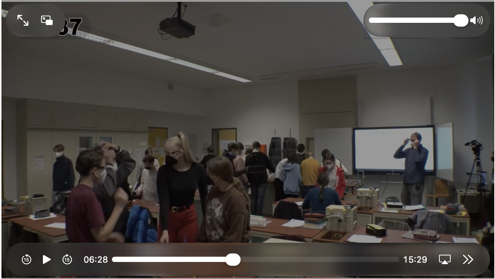

## In diesem Teil  {.center}
* Charakteristika des Lehrer:innenberufs
* Profession - Professionalität - Professionalisierung
* Struktur- und kompetenztheoretischer Ansatz der Professionalität von Lehrer:innen
* Einblicke in Forschungsergebnisse

##  {background-iframe="https://cdn.wordart.com/iframe/hhnsou380o8n" background-interactive=true}

:::footer
:::

## Charakteristika des Unterrichts
Nach Doyle [-@doyle1986] ist Unterricht durch die folgenden Eigenschaften in seiner Besonderheit charakterisiert [@cramer2025professionalitaet]:

::: {style="font-size: 80%;"}
+------------------------+------------------------------------------------------------------------------------------------+
| Multidimensionalität   | Viele, sehr verschiedene Ereignisse finden aufgrund der vielen Personen im Klassenraum statt.  |
+------------------------+------------------------------------------------------------------------------------------------+
| Simultanität           | Viele Dinge geschehen gleichzeitig im Unterricht.                                              |
+------------------------+------------------------------------------------------------------------------------------------+
| Unmittelbarkeit        | Aufgrund des schnellen Ablaufes von Ereignissen im Unterricht ist ein unmittelbares            |
|                        | Lehrer:innenhandeln gefordert, welches eine Reflexion erschwert.                               |
+------------------------+------------------------------------------------------------------------------------------------+
| Unvorhersehbarkeit     | Unterricht kann nicht sicher vorhergesehen und nur beschränkt geplant werden.                  |
+------------------------+------------------------------------------------------------------------------------------------+
| Öffentlichkeit         | Interaktionen finden in einem „öffentlichen“ Raum statt und gehen dabei über den Kreis der     |
|                        | direkt Beteiligten hinaus.                                                                     |
+------------------------+------------------------------------------------------------------------------------------------+
| Historizität           | Gegenwärtiges Handeln im Klassenzimmer hat immer Wurzeln in der Vergangenheit und Auswirkungen |
|                        | in die Zukunft.                                                                                |
+------------------------+------------------------------------------------------------------------------------------------+
| Intransparenz          | Lehrperson und Schüler:innen können gegenseitig nur erahnen, was im jeweils anderen vor sich   |
|                        | geht und nur über (störanfällige) Kommunikation aufeinander Einfluss nehmen.                   |
+------------------------+------------------------------------------------------------------------------------------------+
| Informalität           | Unterrichten ist situativ und nur in geringem Ausmaß standardisierbar oder reglementierbar.    |
+------------------------+------------------------------------------------------------------------------------------------+
:::

##
### Charakteristika des Unterrichts $\overset{?}{\Rightarrow}$ Anforderungen an LuL
> Welche Anforderungen an die Qualitäten von Lehrkräften lassen sich aus diesen Charakteristika ableiten?


## Anforderungen an Lehrer:innen
Diese Charakteristika [@doyle1986] des Kerngeschäfts Unterricht [@tenorth2006c] stehen teilweise im Widerspruch zu personalistischen und praktizistischen Metaphern des Lehrer:innenberufs, nach denen professionelle Lehrer:innen »gute, erfahrene Handwerker«, bzw. »begnadete Erzieher« [@terhart2019] sind:

* Die Tragfähigkeit der praktizistischen Metapher wird vor allem bzgl. des sehr großen Möglichkeitsraumes kritisiert: Im Gegensatz zu etwa der Tätigkeit einer Pilotin, sind einige Tätigkeiten von LuL wesentlich weniger standardisierbar, weshalb »Checklisten« so umfangreich wären, dass sie nicht mehr hilfreich sind
* Personalistische Metaphern werden als  kritisiert [@bromme2008d], da  und  fast gleich sind:

```{typst}
//| format: svg
//| align: center
#set text(size: 18pt)
$
  "gute Lehrer:innenpersönlichkeit" &==> "erfolgreiche Lehrer:in" \
  &approx.eq \
  "gute Lehrer:innenpersönlichkeit" &==> "erfolgreiche Lehrer:in"
$
```

## Begriffe
#### Profession
Aus berufssoziologischer Perspektive wird eine Profession einerseits als besonderer, herausgehobener Beruf aufgefasst [@freidson2001], andererseits als Beruf, der durch Risiken und Ungewissheit in der Ausübung durch Professionelle (Berufsinhabende) charakterisiert ist [@stichweh1994].

#### Professionalität
Professionalität beschreibt die »*spezifische Qualität des beruflichen Handelns*« [@horn2016, S. 156].

#### Professionalismus
Das, was eine Profession ( und kollektiv) unter Professionalität versteht, lässt sich als Professionalismus fassen [@horn2016, S. 156].

## Begriffe
#### Professionalisierung
»*Der Begriff Professionalisierung wird in zwei Absichten verwendet. Bezieht er sich auf die Professionen
selbst, so meint er in historischer Absicht den Transformationsprozess eines gewöhnlichen Berufes hin zur
Profession (Professionwerdung); wird er hingegen auf die Professionellen bezogen, meint er das individuelle
Hervorbringen von Professionalität (Professionellwerden). Heute wird unter Professionalisierung
überwiegend die (individuelle) Entwicklung von Professionalität verstanden.*« [@cramer2025professionalitaet]

# Drei wiss. Ansätze zur Beschreibung der Professionalität von Lehrer:innen

## Studien zur Lehrer:innenexpertise


<center>
[{width=80%}](https://tetfolio.fu-berlin.de/tet/focus-video?vid=184)
</center>


> Beschreiben Sie das beobachtete Unterrichtsgeschehen *charakterisierend* unter https://bab.si/biwi-merk-2627


<!-- https://tetfolio.fu-berlin.de/tet/focus-video?vid=184 -->


## Studien zur Lehrer:innenexpertise
* Quasi-experimentelle Forschung zur Expertise von Berliner et al. [-@berliner1992]
  * Experten, Anfänger und Anwärter beschrieben und interpretierten z.B. Videoaufzeichnungen oder Assessments und Karteikarten
* Expert:innen: Achten z.B. weniger auf unwesentliche Details; haben **Konzepte** typischer Unterrichtsereignisse; betrachten komplexere Analyseeinheiten
* Anfänger:innen: Fokussieren **beobachtbare** Details wie Haarfarbe, Raumanordnung oder Material; beschreiben kleinteiliger

> $\Rightarrow$ Expert:innenwissen führt zu „Veränderung der kategorialen Wahrnehmung von Unterrichtssituationen“ [@bromme2014c]


##  Topologische Ansätze
:::{style="font-size: 80%;"}
Seit den 70er Jahren untersuchen Bildungswissenschaftler:innen [@bromme2008d], in welchem Ausmaß sich Unterrichtserfolge (meist Schüler:innenleistung) durch Merkmale der Lehrer:innen prädizieren lassen. Diese Merkmale werden dann entlang psychologischer Theorien  [@baumert2006; @shulman1986]. Weil angenommen wird, dass die (topologisierten) Merkmale bei höherer Ausprägung die erfolgreiche Bewältigung charakteristischer Anforderungen der Profession wahrscheinlicher machen, werden die topologischen Ansätze auch als kompetenztheoretische Ansätze bezeichnet.
:::
```{typst}
//| label: fig-topologie
//| fig-align: left
//| cap: "Topologie der Aspekte von Lehrer:innenprofessionalität [@baumert2006]"
//| classes: r-stretch


#let main = rgb("#A51E37")

#set page(width: auto, height: auto, margin: (bottom: -40pt))
#set text(
  font: ("Arial"),
  size: 10pt,
  fill: main,
  lang: "de",
)

// Mittelpunkt der Zeichnung in TikZ-Koordinaten (pt, y nach oben)
#let cx0 = -270
#let cy0 = 0

// Ellipse mit Text entlang des Pfads.
// Der Pfad startet wie bei TikZ (arc 360:0) rechts und läuft im Uhrzeigersinn.
// cx, cy: Mittelpunkt; a, b: Halbachsen (pt); size: Schriftgröße;
// raise: Abhebung der Grundlinie in em; pre: Startversatz entlang des Pfads (pt)
#let ring(cx, cy, a, b, body, size, raise, pre) = context {
  let sz = size / 1pt
  let n = 720

  // Stützpunkte und kumulierte Bogenlänge
  let thetas = range(n + 1).map(i => -2 * calc.pi * i / n)
  let pts = thetas.map(t => (a * calc.cos(t), b * calc.sin(t)))
  let cum = (0.0,)
  for i in range(1, n + 1) {
    let ddx = pts.at(i).at(0) - pts.at(i - 1).at(0)
    let ddy = pts.at(i).at(1) - pts.at(i - 1).at(1)
    cum.push(cum.last() + calc.sqrt(ddx * ddx + ddy * ddy))
  }
  let total = cum.last()

  // Winkel zu gegebener Bogenlänge
  let theta-at(len) = {
    let s = calc.rem(len, total)
    let i = 0
    while cum.at(i + 1) < s {
      i += 1
    }
    let f = (s - cum.at(i)) / (cum.at(i + 1) - cum.at(i))
    thetas.at(i) + f * (thetas.at(i + 1) - thetas.at(i))
  }

  // Ellipse zeichnen
  place(
    center + horizon,
    dx: (cx - cx0) * 1pt,
    dy: -(cy - cy0) * 1pt,
    ellipse(width: 2 * a * 1pt, height: 2 * b * 1pt, stroke: 0.4pt + main),
  )

  // Buchstaben einzeln platzieren
  let h = measure(text(size: size, "H")).height / 1pt
  let s = pre
  for ch in body.clusters() {
    let w = measure(text(size: size, ch)).width / 1pt
    let th = theta-at(s + w / 2)

    // Tangente (Uhrzeigersinn) und Normale nach außen
    let tx = a * calc.sin(th)
    let ty = -b * calc.cos(th)
    let l = calc.sqrt(tx * tx + ty * ty)
    let nx = -ty / l
    let ny = tx / l

    let d = raise * sz + h / 2
    let x = cx + a * calc.cos(th) + nx * d
    let y = cy + b * calc.sin(th) + ny * d

    place(
      center + horizon,
      dx: (x - cx0) * 1pt,
      dy: -(y - cy0) * 1pt,
      rotate(
        -calc.atan2(tx, ty),
        box(width: w * 1pt, height: h * 1pt, text(size: size, ch)),
      ),
    )
    s += w
  }
}

// Beschriftung (mehrzeilig, zentriert) an TikZ-Position
#let lbl(x, y, ..lines) = place(
  center + horizon,
  dx: (x - cx0) * 1pt,
  dy: -(y - cy0) * 1pt,
  box(align(center, lines.pos().join(linebreak()))),
)

#let cm = 28.4528 // 1 cm in pt

#box(width: 640pt, height: 450pt)[
  // Große Ellipse
  #ring(-270, 0, 270, 180,
    "Aspekte professioneller Kompetenz im Lehrerberuf",
    24.88pt, 0.55, 28 * cm)

  // Kleine Ellipsen (Mittelpunkt = Startpunkt − (a, 0))
  #ring(-265, -115, 110, 56, "Professionswissen", 14.4pt, 0.35, 10 * cm)
  #ring(-265, 95, 110, 56, "Motivationale Orientierungen", 14.4pt, 0.35, 10.5 * cm)
  #ring(-120, -10, 110, 56, "Selbstregulative Fähigkeiten", 14.4pt, 0.35, 10 * cm)
  #ring(-410, -10, 110, 56, "Überzeugungen und Werthaltungen", 14.4pt, 0.35, 10 * cm)

  // Überzeugungen und Werthaltungen
  #lbl(-470, 5, "Epistemische", "Überzeugungen")
  #lbl(-420, -30, "Lehr-Lerntheoretische", "Überzeugungen")
  #lbl(-370, 10, "…")

  // Professionswissen
  #lbl(-325, -110, "Pädagogisches", "Wissen")
  #lbl(-265, -80, "Fachwissen")
  #lbl(-225, -95, "…")
  #lbl(-240, -125, "Fachdidaktisches", "Wissen")
  #lbl(-298, -140, "Diagnostisches", "Wissen")

  // Motivationale Orientierungen
  #lbl(-325, 100, "Kontroll-", "überzeugungen")
  #lbl(-265, 130, "Enthusiasmus")
  #lbl(-225, 115, "…")
  #lbl(-250, 75, "Selbstwirksamkeit")

  // Selbstregulative Fähigkeiten
  #lbl(-172, 5, "Engagement")
  #lbl(-130, -30, "Distanzierungsfähigkeit")
  #lbl(-80, 3, "…")
]

```

:::footer
:::

## Leuchtturmprojekte ✨
### Topologischer/Kompetenztheoretischer Forschung

:::{style="font-size: 80%;"}
:::: {.columns}

::: {.column width="31%"}
#### [COACTIV ](https://web.archive.org/web/20130114220538/http://www.mpib-berlin.mpg.de/coactiv/index.html)
* Ergänzung zur PISA-Studie 2003/04: Mathematiklehrkräfte der untersuchten Klassen befragt, getestet und um die Abgabe von Unterrichtsmaterialien gebeten
* Kompetenzfacetten: Fachwissen, fachdidaktisches und pädagogisches Wissen; zusätzlich Überzeugungen, Motivation, Selbstregulation
* Verknüpfung mit der Schüler:innenkompetenz im Längsschnitt
:::

::: {.column width="3%"}
:::

::: {.column width="31%"}
#### [TEDS-M ](https://www.teds-unterricht.uni-hamburg.de/weitere-teds-studien/teds-m.html)
* Studie (2006–2009) zur Wirksamkeit der Mathematiklehrer:innenausbildung im internationalen Vergleich
* Angehende Lehrkräfte für Primarstufe und Sekundarstufe I im letzten Ausbildungsjahr
* Kern: mathematisches, mathematikdidaktisches und erziehungswissenschaftliches Wissen sowie Überzeugungen
* Internationaler Vergleich, für Deutschland mit repräsentativer Stichprobe
:::

::: {.column width="3%"}
:::

::: {.column width="31%"}
#### [BilWiss ](https://pd.reha.tu-dortmund.de/forschung/projekte/abgeschlossene-projekte/bilwiss/)
* Forschungsprogramm 2009–2019
* Fokus: Bildungswissenschaftliches Wissen
* Delphi-Studie mit 49 Expert:innen: 104 relevante Themen als Basis eines Wissenstests
* Hauptstudie mit 3.118 Lehramtsabsolvent:innen und Längsschnitt

:::

::::
:::

## Strukturtheoretischer Ansatz {.lightbox}
Der Strukturtheoretische Ansatz ist stark von qualitativ forschenden Soziolog:innen geprägt und fokussiert Rollenerwartungen und soziale Gefüge.

```{typst}
//| format: svg
//| align: left
//| fig-align: left
//| cap: "Sachantinomie als Beispiel"
//| classes: r-stretch
//| label: fig-strukturtheorie
#set page(width: auto, height: auto, margin: 2pt)
#set text(font: "Arial", size: 12pt, lang: "de")
#let blue = rgb("#a51e37")
#let grey = rgb("#a51e3750")

#grid(
  columns: (110pt, 20pt, 300pt, 20pt, 110pt),
  rows: 150pt,
  align: horizon,
  rect(width: 110pt, height: 150pt, fill: grey, stroke: none, inset: 6pt)[
    #align(center + horizon)[
      #text(size: 15pt)[Sache] \
      #v(4pt)
      Vermittlung universaler und abstrakter Inhalte (universitäres Fachwissen)
    ]
  ],
  [],
  box(width: 300pt, height: 150pt)[
    #place(top + left, polygon(fill: blue,
      (0pt, 75pt), (60pt, 0pt), (60pt, 25pt), (240pt, 25pt), (240pt, 0pt),
      (300pt, 75pt), (240pt, 150pt), (240pt, 125pt), (60pt, 125pt), (60pt, 150pt),
    ))
    #place(top + left, dx: 66pt, dy: 30pt, box(width: 168pt, height: 90pt)[
      #align(center + horizon)[
        #text(fill: white, weight: "bold", size: 14pt)[Beispiel: Sachantinomie] \
        #text(fill: white, size: 11pt)[Lehrperson pendelt zwischen den Polen von Antinomien und handelt unter Ungewissheit] \
        #text(fill: rgb("#E6F0FA"), size: 10pt)[(Helsper 1996; 2016)]
      ]
    ])
  ],
  [],
  rect(width: 110pt, height: 150pt, fill: grey, stroke: none, inset: 6pt)[
    #align(center + horizon)[
      #text(size: 15pt)[Person] \
      #v(4pt)
      Reduktion universalen Wissens durch Anpassung an die Lebenswelt der Schüler:innen
    ]
  ],
)
```


#### Antinomien des Lehrpersonenhandelns (Beispiele)
* Person des Schülers versus Anspruch der Sache (siehe @fig-strukturtheorie)
* Nähe versus Distanz zum Schüler
* Autonomie versus Heteronomie
* Organisation und Interaktion

> Professionalität heißt hier, antinomische Spannungen wahrzunehmen, zu reflektieren und im eigenen Handeln in Balance zu bringen


## Leuchtturmprojekte ✨
### Strukturtheoretischer Forschung

:::{style="font-size: 99%;"}
:::: {.columns}

::: {.column width="48%"}
#### [Distinktion im Gymnasialen ](https://www.zsb.uni-halle.de/forschungsprojekte/2503071_2617909/distinktion_im_gymnasialen/?lang=de)
* DFG-Teilprojekt (2011–2019) der Forschergruppe „Mechanismen der Elitebildung“ am ZSB Halle, Leitung Werner Helsper
* Frage: Wie bildet sich Habitus an exklusiven höheren Schulen?
* Fokus: Gymnasien als Feld horizontaler Distinktion und Hierarchisierung
:::

::: {.column width="4%"}
:::

::: {.column width="48%"}
#### [Disziplinierung – Zur Herstellung und Aufrechterhaltung unterrichtlicher Ordnung ](https://www.uni-flensburg.de/erziehungswissenschaften/wer-wir-sind/personen-2/rademacher-sandra-prof-dr/disziplinierung-zur-herstellung-und-aufrechterhaltung-unterrichtlicher-ordnung)
* Projekt von Sandra Rademacher (Europa-Universität Flensburg), Laufzeit 2011–2016
* Verbindet professionalisierungs- mit sozialisationstheoretischen Fragen
* Empirische Betrachtung des Professionalisierungsmodells zur Disziplinierung
* Datenbasis: Beobachtungsprotokolle und Transkripte aus Grund- und weiterführenden Schulen, Klassen 1 bis 12
:::


::::
:::

# Einblicke in Forschungsergebnisse


## Literatur
:::footer
:::
