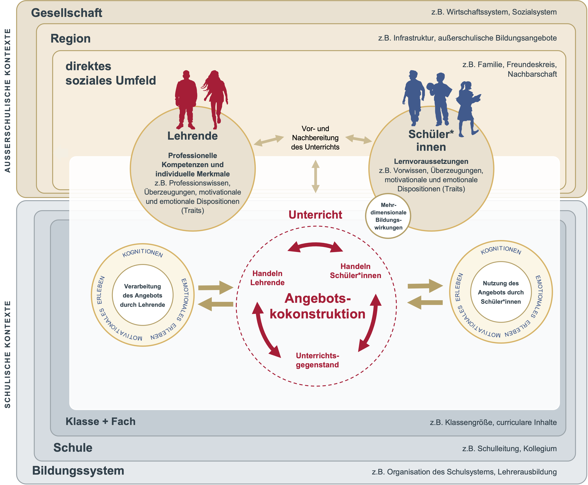

```{r}
#| include: false
knitr::knit_engines$set(typst = function(options) {
  knitr::asis_output(paste0("\n```{.typst-render-cell}\n", paste(options[["code"]], collapse = "\n"), "\n```\n"))
})
```


## Warm-Up 
> Wiederholen Sie Definitionen der folgenden Erkenntnisinteressen und geben Sie jeweils ein bildungswissenschaftliches Beispiel an.

:::: {.columns}

::: {.column width="33%"}
::: {.panel-tabset}
#### Begriff
**Explanatives Interesse**

#### Def. & Bsp.
::: {style="font-size:80%"}
**Definition:** Erkenntnisinteressen, die prüfen, ob eine Hypothese, dass eine Größe eine andere beeinflusst, zutrifft.

**Beispiel:** Verbessert kooperatives Lernen die Mathematikleistung von Schüler:innen im Vergleich zu Frontalunterricht?
:::
:::
:::

::: {.column width="33%"}
::: {.panel-tabset}
#### Begriff
**Deskriptives Interesse**

#### Def. & Bsp.
::: {style="font-size:80%"}
**Definition:** Erkenntnisinteressen, die Merkmale, Häufigkeiten oder Verteilungen eines Phänomens beschreiben, ohne sich für dessen Ursachen oder Wirkungen zu interessieren.

**Beispiel:** Wie viele Stunden pro Woche wenden Lehrkräfte durchschnittlich für Unterrichtsvorbereitung auf?
:::
:::
:::

::: {.column width="33%"}
::: {.panel-tabset}
#### Begriff
**Emanzipatives Interesse**

#### Def. & Bsp.
::: {style="font-size:80%"}
**Definition:** Erkenntnisinteressen, die darauf abzielen, Abhängigkeiten und Benachteligungen aufzudecken und Beteiligte zu befähigen, ihre Situation selbstbestimmt zu verändern.

**Beispiel:** Wie reproduzieren Hidden Curricula soziale Ungleichheit?
:::
:::
:::

::::

## In diesem Teil  {.center}
* Bildungswissenschaftliche Perspektiven auf Unterricht
    * Historische Zugänge
    * Didaktik (im engeren Sinne)/Curriculum Studies
    * Methodik
    * Unterrichtsqualitätsforschung/Lehr-Lernforschung
* Beispiele für die Perspektiven
* Kritische Würdigung der Perspektiven
* Forschungsorientierte Vertiefung: Basisdimensionen der Unterrichtsqualität


## Vorwissensaktivierung {.center}
> Beschreiben Sie in drei Schlagworten oder Stichpunkten, was Ihrer Meinung und Erfahrung nach guten Unterricht ausmacht unter [https://bab.si/biwi-merk-2627](https://bab.si/biwi-merk-2627)

##
### Bildungswissenschaftliche Perspektiven auf Unterricht
Sehr stark zusammenfassend kann der Blick der Bildungswissenschaften auf »Unterricht« in folgende Phasen/Strömungen/Perspektiven unterteilt werden:

* Historische Zugänge wie z.B. der  bei Herbart [-@herbart1887zwei; @vanmanen1995]
*  beschäftigen sich primär mit der Frage, anhand welcher Prinzipien die Auswahl von Unterrichtsinhalten gerechtfertigt erfolgen und wie Unterrichtsabläufe geplant werden können.
* Ein Fokus auf die  bedeutet das Bearbeiten von Fragen konkreter, beobachtbarer unterrichtlicher Maßnahmen wie Raumgestaltung, Sozialformen, Medien etc.
* Die  befasst sich mit dem Zusammenhang von abstrahierten Unterrichtsmerkmalen wie z.B. »kognitiver Aktivierung« oder »Reibungslosigkeit« und »Outcomes« wie z.B. Lernzuwachs, Motivation oder Wohlbefinden.

## Beispiel: Historischer Zugang {.scrollable}
### Der pädagogische Takt bei Herbart

* **Das Grundproblem (Spannungsverhältnis von Theorie & Praxis):**
    * Abstrakte Theorien sind zu allgemein für die Verhältnisse konkreter Unterrichtssituationen
    * Der unmittelbaren Praxis fehlt die reflektierende Distanz zur theoretischen Abwägung
    * Der pädagogische Takt schiebt sich unwillkürlich zwischen Theorie und Praxis
    * Er nimmt genau den Platz ein, den die wissenschaftliche Theorie notwendig »leer ließ«
* **Wesen und Funktion des pädagogischen Takts:**
    * **Unmittelbare Urteilskraft:** Intuitive, normativ-praktische Urteilskraft im Augenblick des Handelns (»wissender Körper«)
    * **Situationssensibilität:** Wahrnehmung kindlicher Bedürfnisse, emotionales Feingefühl und Gespür für Grenzen
    * **Taktvolle Zurückhaltung:** Gewahren von angemessenem Abstand und aufmerksamem Gewährenlassen im Unterrichtsfluss

:::{.footer}
:::

## Beispiel: Didaktik (im engeren Sinne) {.scrollable}
### Bildungstheoretische Didaktik nach Wolfgang Klafki [-@klafki1959]
* **Zentralkategorie Bildung:** Bildung als selbsttätig erarbeiteter und personal verantworteter Zusammenhang dreier Grundfähigkeiten:
    * **Selbstbestimmung** jedes Einzelnen
    * **Mitbestimmung** in gesellschaftlichen Angelegenheiten
    * **Solidarität** bei der Bewältigung gemeinsamer Probleme
* **Inhaltsbezug:** Orientierung an **epochaltypischen Schlüsselproblemen** (z.B. Friedensfrage, Umweltfrage, gesellschaftliche Ungleichheit)
* **Kritisch-konstruktiv:**
    * **Kritisch:** Befähigung der Schüler:innen zu wachsender Selbstbestimmung, Mitbestimmung und Solidarität
    * **Konstruktiv:** Praxisbezug, Handlungs- und Gestaltungsinteresse
* **Lernen als Interaktion:** Entdeckendes, sinnhaftes und verstehendes Lernen; Unterricht muss diskursiv gerechtfertigt und geplant werden


:::{.footer}
:::


## Beispiel: Methodik {.scrollable}
### Das Churer Modell (Reto Thöny)

* **Pädagogische Zielsetzung & Heterogenität:**
    * **Umgang mit Vielfalt:** Konstruktive Differenzierung und Förderung im regulären Klassenraum
    * **Förderstruktur:** Verbindet Regelunterricht, individuelle Förderung und integrative Begabungsförderung
    * **Zielwerte:** Stärkung von Selbstständigkeit, Partizipation und überfachlichen Kompetenzen
* **Veränderte Raumstruktur:**
    * **Veränderte Ausrichtung:** Aufbrechen der starren Frontalausrichtung zur Wandtafel.
    * **Lernlandschaft:** Bereitstellung unterschiedlicher Arbeitsplätze mit freier Platzwahl für Schüler:innen
    * **Sitzkreis:** Zentraler Ankerpunkt für Lerninputs, gegenseitigen Austausch und Reflexion
* **Drei Kernelemente des Unterrichtsablaufs:**
    * **1. Kurz-Input im Kreis (max. 10–12 Min.):** Vorstellung der Lernziele und Präsentation differenzierter Lernaufgaben
    * **2. Vertiefung an Lernaufgaben:** Selbsteinschätzung des Anspruchsniveaus; freie Wahl von Arbeitsplatz und Lernpartner:in; Lehrkraft agiert als individuelle Lernbegleitung
    * **3. Lernreflexion im Kreis:** Auswertung der Lernerfahrungen und Nachdenken über eigene Lernwege.
* **Stufen der Unterrichtsöffnung:**
    * Schrittweise Öffnung in organisatorischer, methodischer, inhaltlicher und zeitlicher Hinsicht.

:::{.footer}
:::

## Beispiel: Unterrichtsqualitätsforschung {.scrollable}
### Basisdimensionen von Unterrichtsqualität
* **Sicht- vs. Tiefenstrukturen:**
    * **Sichtstrukturen:** Beobachtbare Methoden, Sozialformen und Medien bilden den äußeren Rahmen mit geringer Erklärungsleistung für den Lernerfolg
    * **Tiefenstrukturen:** Steuern die Qualität der Verstehens- und Informationsverarbeitungsprozesse im Unterricht indem sie Angebote für diese machen
* **Die drei Basisdimensionen im Detail:**
    * **1. Klassenführung:**
        * Effektive Störungsprävention durch Allgegenwärtigkeit und Reibungslosigkeit (nach Kounin)
        * Maximierung der aktiven Lernzeit (*time on task*)
    * **2. Kognitive Aktivierung:**
        * Anregung zu vertieftem Nachdenken (*higher order thinking*), Anknüpfen an Vorwissen und Auseinandersetzung mit kognitiven Konflikten
    * **3. Konstruktive Unterstützung:**
        * Wertschätzende Lehr-Lern-Beziehung, individuelle Hilfestellungen bei Verständnisproblemen und förderliche Fehlerkultur
* **Wirkungsweise auf Schüler-Outcomes:**
    * **Leistungsentwicklung:** Primär bestimmt durch hohe Klassenführung und kognitive Aktivierung
    * **Motivation & Interesse:** Primär gefördert durch konstruktive Unterstützung und gute Klassenführung

:::{.footer}
:::


## Kritische Würdigung der Perspektiven {.scrollable}
### Historische Zugänge

* **Stärken:**
    * **Historische Relativierung:** Vermeintlich neue Konzepte erweisen sich oft als Neubeschreibung älterer Ideen, z.B. konstruktivistische Empfehlungen als Wiederkehr reformpädagogischer Methodenpostulate [@terhart2002]
    * **Begriffe für das Unbestimmte:** Konzepte wie der pädagogische Takt benennen Aspekte des Lehrerhandelns, die sich oft bis heute schwer fassen lassen
* **Grenzen:**
    * **Programmatik statt Beschreibung:** Klassische Texte sagen viel darüber, wie Unterricht sein *soll*, aber wenig darüber, wie er tatsächlich *war* oder *ist*
    * **Schwer prüfbar:** Zentrale Begriffe (z.B. Takt) sind kaum operationalisierbar; ob und wie sie Lernen beeinflussen, bleibt offen
    * **Gefahr der Klassikerverehrung:** Historische Positionen werden leicht als zeitlose Autoritäten statt als zeitgebundene Antworten auf zeitgebundene Probleme gelesen [@tremp2020; @winkler1994]

:::{.footer}
:::

## Übungsaufgabe: Perspektiven  {.center}
> Bearbeiten Sie bitte die Aufgabe [Perspektiven auf Unterricht erkennen ](../uebungsaufgaben.qmd#perspektiven-auf-unterricht-erkennen)

## Kritische Würdigung der Perspektiven {.scrollable}
### Didaktik im engeren Sinne/Curriculum Studies

* **Stärken:**
    * **Normative Fragen im Blick:** Fragt nicht nur *wie*, sondern auch *was* und *warum* gelernt werden soll (Bildung, Inhaltsauswahl, gesellschaftliche Ziele) [@terhart2019]
    * **Weiter Lernbegriff:** Bezieht kognitive, emotionale, ästhetische, soziale und moralische Dimensionen des Lernens ein [@gudjons2025]
    * **Orientierung für die Planung:** Liefert Fragelisten und Schemata zur Unterrichtsvorbereitung, v.a. in der Lehrkräftebildung
* **Grenzen:**
    * **Kaum empirisch fundiert:** Allgemeine Didaktiken sind weitgehend aus Praktikerwissen im Kontext der Lehrkräftebildung entstanden, nicht aus Forschung [@terhart2002]
    * **Geringe Praxisrelevanz für Erfahrene:** Studien zum Planungshandeln zeigen, dass allgemeindidaktische Modelle für erfahrene Lehrkräfte kaum eine Rolle spielen [@wernkestephan2018]
    * **Wirkungsblindheit:** Die Frage, ob der geplante Unterricht tatsächlich wirkt (Lernkontrolle, Diagnostik), bleibt vielfach unberücksichtigt

:::{.footer}
:::

## Kritische Würdigung der Perspektiven {.scrollable}
### Methodik

* **Stärken:**
    * **Handlungsnah:** Bezieht sich auf konkrete, beobachtbare und unmittelbar gestaltbare Entscheidungen (Raum, Sozialform, Medien, Ablauf)
    * **Anschlussfähig an Praxis:** Methoden lassen sich gut vermitteln, erproben und im Kollegium austauschen
    * **Differenzierung:** Viele Methoden (z.B. Stationenlernen, Churer Modell) bieten Strukturen für den Umgang mit Heterogenität und damit für eine von Lehrer:innen als zentral empfundene Herausforderung [@wernkestephan2018; @jude2026schulbarometer]
* **Grenzen:**
    * **Sichtstrukturen erklären wenig:** Ob eine Methode wirkt, hängt weniger von der Methode selbst ab als von der Qualität ihrer Umsetzung (Tiefenstrukturen) [@kunter2013b; @seidel2007]
    * **Normativ aufgeladen:** Methoden werden oft als »modern« oder »schülerorientiert« empfohlen, ohne dass ihre Wirksamkeit belegt ist
    * **Positivistisch:** Fokus auf beobachtbare Maßnahmen und deren Effekte, ohne normative/emanzipative Fragen zu stellen (z.B. »Was soll warum gelernt werden?«)

:::{.footer}
:::

## Kritische Würdigung der Perspektiven {.scrollable}
### Unterrichtsqualitätsforschung/Lehr-Lernforschung

* **Stärken:**
    * **Empirisch prüfbar:** Theoriegeleitete Beschreibung, Erklärung und Optimierung von Lehr-Lern-Prozessen mit kumulierbaren Befunden [@terhart2002]
    * **Robuste Rahmenmodelle:** Basisdimensionen (Klassenführung, kognitive Aktivierung, konstruktive Unterstützung) haben sich über viele Studien bewährt [@kunter2013b] <!-- Zitationsvorschlag: Praetorius et al. (2018) -->
* **Grenzen:**
    * **Positivistisch:**
    * **Tiefenstrukturen wenig greifbar/heuristisch:** Abstrakte Basisdimensionen erlauben kaum Ableitung konkreter Handlungsimplikationen
    * **Mess- und Kausalitätsprobleme:** Unterrichtsqualität ist schwer zuverlässig zu messen, Designs sind häufig korrelativ [@berliner2002]

:::{.footer}
:::

# Drei Basisdimensionen von Unterrichtsqualität
## {.center}
### Ihre Merkmale von Unterrichtsqualität {.center}
> Welche der von Ihnen genannten Merkmale von Unterrichtsqualität würden Sie welcher Perspektive zuordnen?


## {.center}
### Perspektiven auf Unterrichtsqualität und deren Erkenntnisinteressen {.center}

> Übung: Ordnen Sie [in dieser Übungsaufgabe](../uebungsaufgaben.qmd#erkenntnisinteressen-den-perspektiven-auf-unterricht-zuordnen) ausgewählten bildungswissenschaftlichen Perspektiven Erkenntnisinteressen zu.

## Herkunft und Bedeutung der Basisdimensionen {.scrollable}
* Die Basisdimensionen entstammen einem langjährigen Forschungsprogramm, begonnen mit der Pythagoras-Videostudie [@klieme2006]
* Sie sind parallel zu einer Vielzahl an Kriterienkatalogen entstanden, deren Konstruktvalidität nicht immer klar war.
    * Helmke [-@helmke2006] nennt z.B. als Merkmale *effiziente Klassenführung* und *Zeitnutzung*, *lernförderliches Unterrichtsklima, vielfältige Motivierung, Strukturiertheit* und *Klarheit*, *Wirkungs- und Kompetenzorientierung*, *Schülerorientierung* und *Unterstützung*, *Förderung aktiven, selbstständigen Lernens*, *angemessene Variation von Methoden und Sozialformen*, *Konsolidierung*, *Sicherung* und *intelligentes Üben* sowie *Passung*.
    * Lipowsky [-@lipowsky2009a] nennt z.B. als Merkmale *Strukturiertheit*, *inhaltliche Klarheit* und *Kohärenz* des Unterrichts, *Feedback*, *kooperatives Lernen*, *Übungen*, *kognitive Aktivierung* und ein *unterstützendes Unterrichtsklima*.
* Die drei Basisdimensionen werden mittlerweile nicht nur in der Unterrichtsqualitätsforschung betrachtet, sondern haben auch Eingang in die Lehrkräfteaus- und fortbildung gefunden [@fauth]


:::{.footer}
:::


## Die drei Basisdimensionen im Überblick {.scrollable}

:::: {.columns}

::: {.column width="50%"}
```{typst}
//| label: fig-basisdimensionen-und-indikatoren
//| cap: "Basisdimensionen und deren Indikatoren nach Fauth et al. [-@fauth]"
#set page(width: auto, height: auto, margin: (x: 12pt, top: 12pt, bottom: -12pt), fill: rgb("#F2F4F4"))
#set text(font: ("Arial", "Arial", "Arial", "Arial"), size: 11pt, fill: rgb("#1f1f33"))

#let rot = rgb("#A51E37")
#let gold = rgb("#B4A069")
#let anthrazit = rgb("#32414B")

#let u = 0.4pt
#let r = 14
#let ox = 160   // linker Rand, damit die langen Labels Platz haben
#let P = 65     // Abstand der Item-Mitten innerhalb einer Gruppe

// Text vertikal zentriert an (x, y); al = left: Text beginnt bei x, right: Text endet bei x
#let at(x, y, al, body) = place(
  top + left, dx: (x + ox) * u, dy: y * u,
  context {
    let b = box(body)
    let m = measure(b)
    move(dx: if al == right { -m.width } else { 0pt }, dy: -m.height / 2, b)
  },
)

#let bracket(x0, y0, xt, x1, y1, col) = {
  let p(x, y) = ((x + ox) * u, y * u)
  if y0 == y1 {
    place(top + left, curve(stroke: (paint: col, thickness: 1.3pt), curve.move(p(x0, y0)), curve.line(p(x1, y1))))
  } else {
    let s = if y1 > y0 { 1 } else { -1 }
    place(top + left, curve(
      stroke: (paint: col, thickness: 1.3pt),
      curve.move(p(x0, y0)),
      curve.line(p(xt - r, y0)),
      curve.quad(p(xt, y0), p(xt, y0 + s * r)),
      curve.line(p(xt, y1 - s * r)),
      curve.quad(p(xt, y1), p(xt + r, y1)),
      curve.line(p(x1, y1)),
    ))
  }
}

#let group(label, c, items, offs, trunks, col) = {
  at(268, c, right, text(fill: col, weight: "bold", label))
  let n = items.len()
  for (i, txt) in items.enumerate() {
    let y = c + (i - (n - 1) / 2) * P
    bracket(280, c + offs.at(i), trunks.at(i), 360, y, col)
    at(372, y, left, txt)
  }
}

#box(width: 900 * u, height: 940 * u)[
  #group([Kognitive Aktivierung], 240,
    ([Verständnisorientierung], [Ermittlung Denkweisen], [Herausforderung], [Engagement der SuS]),
    (-20, -4, 12, 28), (305, 333, 333, 305), rot)
  #group([Konstruktive Unterstützung], 545,
    ([Qualität des Feedbacks], [Unterstützung], [Wertschätzung & Respekt], [Klassenklima]),
    (-23, -7, 11, 27), (305, 333, 333, 305), gold)
  #group([Strukturierte Klassenführung], 817.5,
    ([Störungen durch SuS], [Monitoring], [Zeitnutzung]),
    (-18, 0, 22), (305, 333, 305), anthrazit)
]
```
:::

::: {.column width="50%"}

:::

::::

:::{.footer}
:::

## Die drei Basisdimensionen  {.center}
### Übungen

> Barbeiten Sie die Übungsaufgabe [»*Merkmale von Unterrichtsqualität den Basisdimensionen zuordnen*«](../uebungsaufgaben.qmd#merkmale-von-unterrichtsqualität-den-basisdimensionen-zuordnen).

## Die drei Basisdimensionen
### Tiefenstrukturen und Nutzungsverschränkung


::: {.columns}

::: {.column}

```{typst}
//| label: fig-angebot-nutzung-alpchrist
//| cap: "Angebot- und Nutzungsverschränkung der Baisdimensionen nach Klieme et al .[-@klieme2009pythagoras] und Alp Christ et al. [-@alpchrist2024]"
#set page(width: auto, height: auto, margin: (x: 0pt, top: 0pt, bottom: -30pt), fill: rgb("#F2F4F4"))
#set text(font: ("Arial", "Arial", "Arial", "Arial"), size: 11pt, fill: rgb("#1f1f33"))

#let rot = rgb("#A51E37")
#let gold = rgb("#B4A069")
#let anthrazit = rgb("#32414B")
#let ink = anthrazit
#let k = 0.5pt  // 1 Einheit = 0.5pt, Koordinaten in Pixeln der Vorlage

#let at(x, y, body) = place(top + left, dx: x * k, dy: y * k, body)

#let node(x, y, w, h, label, col: ink) = at(x, y, rect(
  width: w * k, height: h * k, radius: 8pt, inset: 1pt, stroke: 1.3pt + col,
  align(center + horizon, text(fill: col, weight: "bold", label)),
))

#let head(tx, ty, ux, uy) = {
  let bx = tx - 14 * ux
  let by = ty - 14 * uy
  at(0, 0, curve(
    fill: ink, stroke: none,
    curve.move((tx * k, ty * k)),
    curve.line(((bx - 6 * uy) * k, (by + 6 * ux) * k)),
    curve.line(((bx + 6 * uy) * k, (by - 6 * ux) * k)),
    curve.close(),
  ))
}

#let arr(x1, y1, x2, y2, both: false) = {
  let dx = x2 - x1
  let dy = y2 - y1
  let len = calc.sqrt(dx * dx + dy * dy)
  let ux = dx / len
  let uy = dy / len
  let bx = x2 - 14 * ux
  let by = y2 - 14 * uy
  let sx = if both { x1 + 14 * ux } else { x1 }
  let sy = if both { y1 + 14 * uy } else { y1 }
  at(0, 0, curve(
    stroke: 1pt + ink,
    curve.move((sx * k, sy * k)),
    curve.line((bx * k, by * k)),
  ))
  head(x2, y2, ux, uy)
  if both { head(x1, y1, -ux, -uy) }
}

#box(width: 1480 * k, height: 700 * k)[
  #at(37, 60, box(width: 318 * k, height: 130 * k, align(bottom + center, text(size: 14pt, weight: "bold", [Opportunities \ provided]))))
  #at(593, 60, box(width: 318 * k, height: 130 * k, align(bottom + center, text(size: 14pt, weight: "bold", [Students' use of \ learning opportunities]))))
  #at(1148, 60, box(width: 318 * k, height: 130 * k, align(bottom + center, text(size: 14pt, weight: "bold", [Outcomes]))))

  #node(37, 230, 318, 100, [Cognitive activation], col: rot)
  #node(37, 380, 318, 100, [Classroom management], col: anthrazit)
  #node(37, 530, 318, 100, [Student support], col: gold)
  #node(593, 230, 318, 100, [Depth of processing])
  #node(593, 380, 318, 100, [Time-on-task])
  #node(593, 530, 318, 100, [Need satisfaction])
  #node(1148, 280, 318, 100, [Achievement])
  #node(1148, 480, 318, 100, [Motivation])

  #arr(355, 280, 593, 280)
  #arr(355, 430, 593, 300)
  #arr(355, 430, 593, 430)
  #arr(355, 430, 593, 560)
  #arr(355, 580, 593, 580)
  #arr(911, 280, 1148, 300)
  #arr(911, 430, 1148, 355)
  #arr(911, 580, 1148, 530)
  #arr(1307, 381, 1307, 479, both: true)
]
```


:::

::: {.column}

Die links dargestellten Mediationszusammenhänge (Basisdimensionen als , Outcomes als , Lerngelegenheiten als ) werden in der Unterrichtsqualitätsforschung immer wieder postuliert. Empirisch werden sie selten geprüft und wenn, dann eher nur querschnittlich gefunden [@alpchrist2024].

:::

:::

## Die drei Basisdimensionen  {.center}

> Bearbeiten Sie die Übungsaufgabe [»*Unabhängige, mediierende und abhängige Variablen identifizieren*«](../uebungsaufgaben.qmd#unabhängige-mediierende-und-abhängige-variablen-identifizieren)


## Die drei Basisdimensionen
### Unterrichtsqualität als reziprokes Produkt

::: {.columns style="display: flex !important; align-items: center;"}
::: {.column width="30%"}
{.lightbox}
:::

::: {.column width="70%"}
Moderne empirische Unterrichtsqualitätsforschung geht davon aus, dass Unterrichtsqualität nicht nur einseitig von Lehrkräften bestimmt wird, sondern dass sie ein reziprokes Produkt von Schüler:innen- und Lehrkäftehandlungen sowie von Kontextbedingungen ist [@vieluf2020]. Demnach müssten zum einen vergleichsweise stabile Lehrer:innemerkmale wie fachdidaktisches und pädagogisches Wissen Unterrichtsqualität beeinflussen, zum anderen aber auch die Unterrichtsqualität in eienr Klasse bei verschiedenen Lehrkräften ähnlicher sein, als die Unterrichtsqualität in verschiedenen Klassen bei unterschiedlichen Lehrkräften.
:::
:::

## Die drei Basisdimensionen
### Schüler- und Lehrer:innenreprozität einschätzen
> Korrelation von UnterrichtsqualitätPädagogischem/Psychologischem Wissen: Nehmen Sie auf der App []() eine Einschätzung vor
* Korrelation von Unterrichtsqualität bei gleichen Klassen und unterschiedlichen/gleichen Lehrkräften


## Literatur {.center}
:::{.footer}
:::
