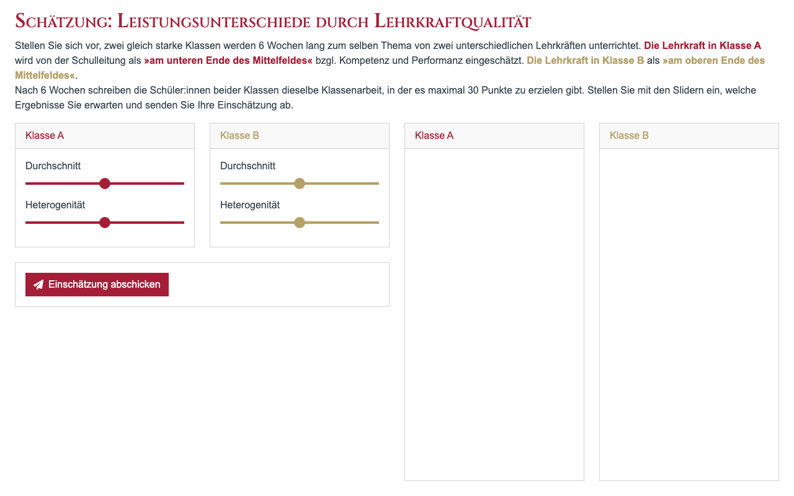
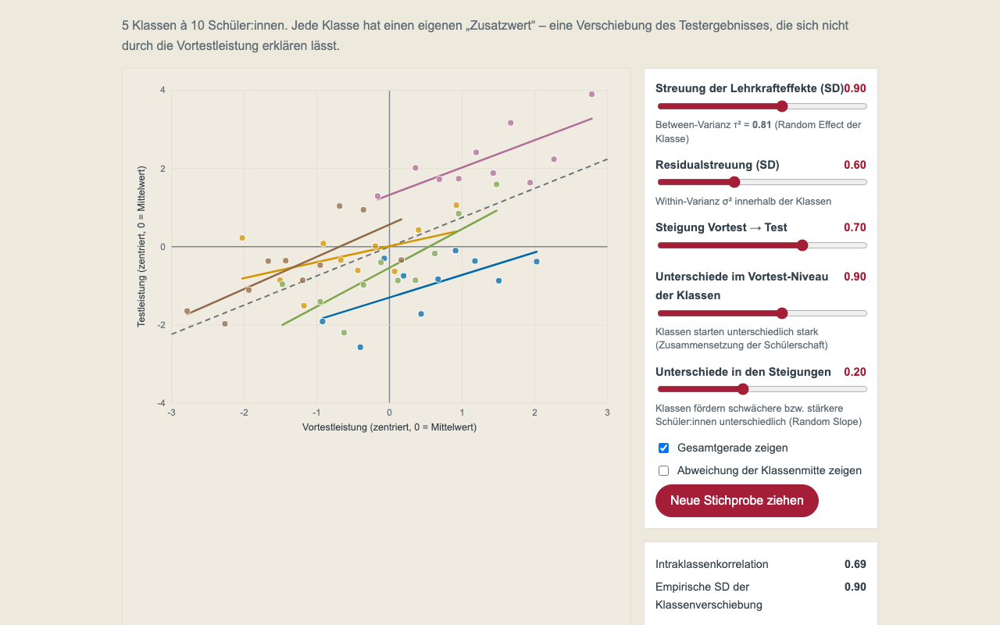
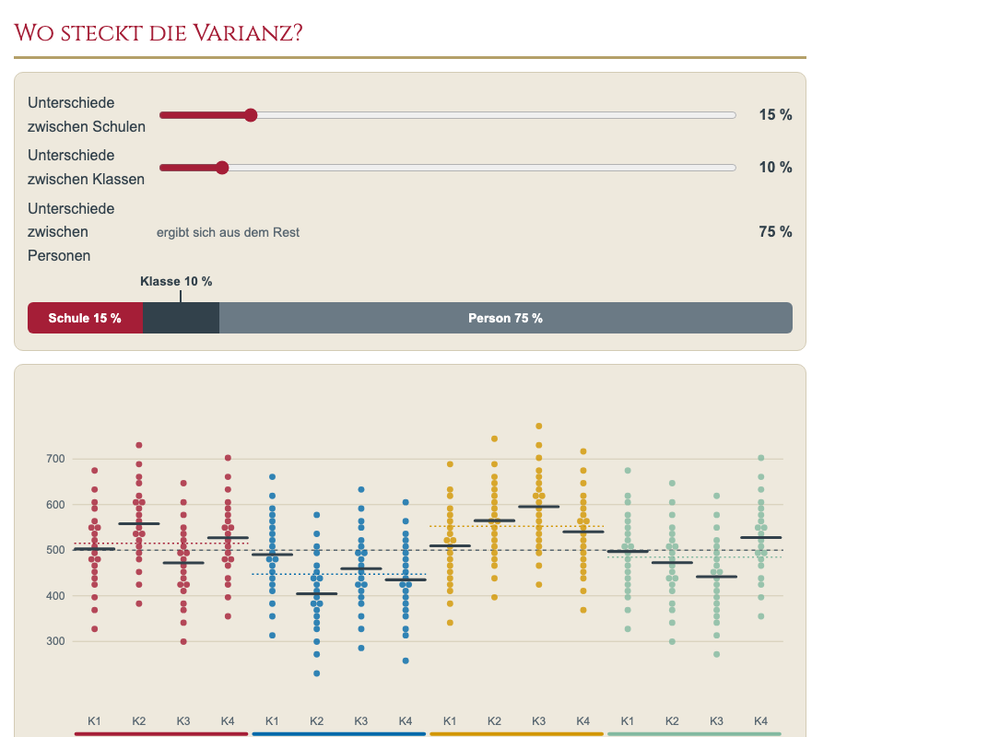
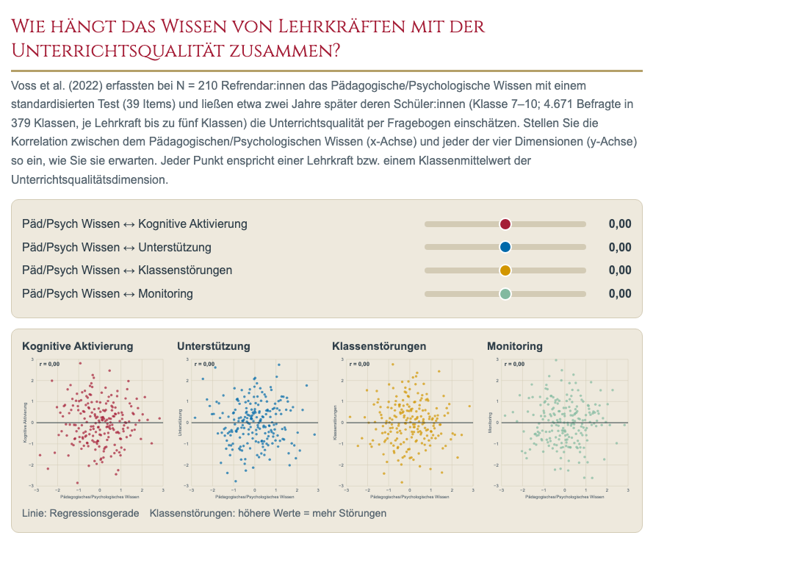
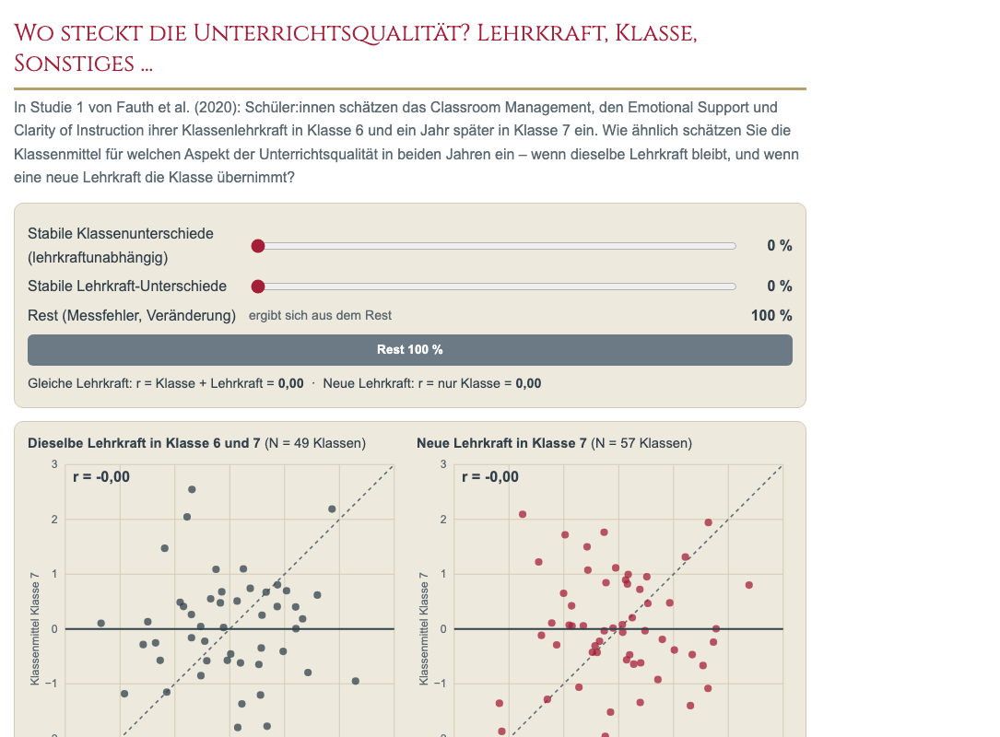

## Teil 2 - Professionalität

### Schätzung: Leistungsunterschiede durch Lehrkraftqualität

[{width=60%}](apps/Teil%202%20-%20Professionalität/effsize-teacherqual.html){target="_blank"}

### Teacher Added Value

[{width=60%}](apps/Teil%202%20-%20Professionalität/teacher-added-value.html){target="_blank"}

## Teil 3 - Unterricht

### Wo steckt die Varianz? Schule, Klasse, Schüler:in

[{width=60%}](apps/Teil%203%20-%20Unterricht/wo-steckt-die-varianz.html){target="_blank"}

### Wie hängt Lehrkräftewissen mit Uqual zusammen?

[{width=60%}](apps/Teil%203%20-%20Unterricht/lehrkraeftewissen-uqual-studis.html){target="_blank"}

### Wo steckt die Uqual?

[{width=60%}](apps/Teil%203%20-%20Unterricht/wo-steckt-die-uqual.html){target="_blank"}
